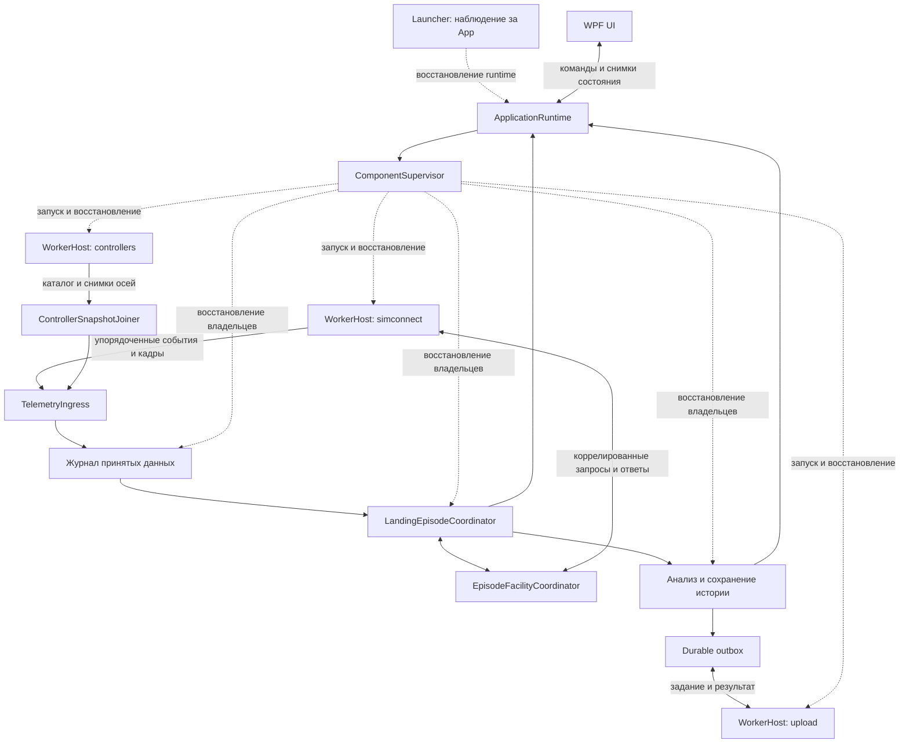

# План рефакторинга runtime: изоляция, автоматическое восстановление и бэклог

**Опубликовано 18.10.2026:** реализованная клиентская часть выпущена в
[0.9.5](https://github.com/Arderos/msfs24-landing-stats/releases/tag/v0.9.5).
Unsigned и подписанный CI прошли; проверены обновления всех 22 старых клиентов
и скачанные файлы релиза. Подписание выполнено одним проходом, без повторов.
Актуальная область публикации и доказательства — в разделе «Публикация 0.9.5»
[бэклога](../BACKLOG.md). Исследовательская часть P9/LS-008 остаётся открытой;
прежние даты и ограничения ниже сохранены как история.

Дата: 2026-10-16. Основание: исходник `3297bf38db7810375f7b97ba2d735119df450b30`, текущий рабочий `BACKLOG.md`, локальные исследования 14–16 октября. Статус на 18 октября: P1–P8/P10 реализованы; локальная P11-проверка после исправления итогового ревью завершена. Результаты прежней сборки и живого полёта сохранены ниже с их границами; они не подменяют проверку нового исходника. P9/LS-008 остаётся исследованием. Подпись, публикация и deployment не выполнялись.

**Уточнение после сравнения с 0.9.4, 18.10.2026:** прежний итог локальной P11
не закрывает шесть вновь подтверждённых случаев. Открыты lifecycle после
overflow (LS-008), no-source simulator pitch (LS-032), completion opt-out
(LS-012), deferred update (LS-038), обогащение старой истории (LS-039) и
сброс simulator control event на inferred boundary (LS-040). Поведенческую
приёмку P3/P5/P6/P7/P8/P11 нельзя считать завершённой до их исправления и
профильных проверок. [Отчёт и доказательства](../behavior-review-2026-10-18.md).
Согласованные M01/fingerprint/Drive изменения отделены от регрессий; прежние
результаты ниже сохранены как история. Исходник в этом аудите не исправлялся.

**Исправления после аудита, 18.10.2026:** B-01–B-06 реализованы локально одним
агентом по поручению пользователя. Профильные проверки lifecycle/контролов,
WPF/history/update и публичного opt-out проходят. Итог: 308 App-проверок PASS
совокупно (307 общим прогоном плюс повтор исправленного fixture), протокол
на net48/net10 и прежний engine проверены; живой MSFS smoke не запускался.
[Отдельный отчёт](behavior-fixes-2026-10-18.md)
содержит актуальную проверку; опубликованной версии нет. Это закрывает перечисленные
шесть отклонений, но не переводит исследовательскую часть LS-008/P9 в завершённую.

### Повторная проверка по ревью, 2026-10-17

Сведения о 280 PASS и живом полёте ниже относятся к срезу **до** исправлений
итогового ревью. Они сохраняются как история, а не как подтверждение новой сборки.
Текущий реестр — `artifacts/review-remediation-20261017/findings.json`:
169 уникальных пунктов: 163 исправлены и проверены, 2 имеют явные ограничения,
4 разобраны как неподтвердившиеся замечания, дубли или допустимое поведение.
Исходный `code-review-report-2026-10-17.md` сохранён без изменения.

P2/P3/P5 приведены к физической границе сборок: Models, Persistence, Recording,
Storage, Delivery, Runtime, Common и пять модулей ролей. WorkerHost загружает
модуль своей роли; Analysis/Upload/Cloud проверены без WPF EXE. Тестовые роли
вынесены в непоставляемую сборку. Непотребляемые элементы каталога и второй
алгоритм ingress удалены. Реестр описывает фактические владельцы и их policy.

P4: завершённые outbox/intake записи компактируются в постоянный индекс
receipts; pending/quarantine bytes сохраняются. Удаление временной копии требует
доказанного совпадения с опубликованными байтами; неизвестная или единственная
копия не считается мусором. Повреждённый manifest не закрепляет все будущие
engines навсегда. Проверка постоянной недоступности storage использует реальные
production deadlines: запуск/остановка завершаются, ложного ACK нет, ошибки
сохранены, освобождение одного владельца не мешает освобождению остальных.

Локальные целевые проверки прошли: adversarial IPC/command recovery, реальный
App/guardian, 100 process failures, durable storage, cloud, history/UI/replay,
net48/net10 contracts и archives, 134 server tests, три unsigned package suite.
Финальный общий suite `full-regression-06.log`: **289 PASS, 0 FAIL**.
Нативный source smoke, намеренно выключенный в общем запуске, отдельно прошёл
status/probe/stop без запущенного MSFS (`native-smoke-final.log`). Нативные интерактивные/field checks, новая подпись,
публикация и deployment не объявляются результатом этих локальных проверок.
P9/LS-008 остаётся исследованием; LS-001 сохраняет принятый best effort статус.

### Итог проверки ревью, 18 октября

- `build-13.log` и сборка final unsigned package: 0 warnings/errors. Все 32 файла
  payload побайтно совпадают с immutable regression snapshot13; тестовая DLL в
  пакет не входит. Три package suite прошли. `verification-summary.json` и
  `package-final-hashes.json` связывают результаты с точными бинарниками.
- Все 1496 архивов: 2 237 624 кадра, 948 контактов, те же 8 известные synthetic
  detail-layout-0 failures. Первичные метрики и время контактов неизменны.
  M-01 меняет только пять производных полей в 208 контактах из 186 архивов;
  максимальное изменение closure/residual 12.3837319538 fpm. Полный контроль с
  возвратом только старой формулы совпал с P11 поле в поле. На финальной13 все
  186 затронутых архивов проверены в обеих ветках: current2 совпадает с исправленной
  моделью, legacy1 — с прежней. Старый сериализованный snapshot без revision
  выбирает legacy1; новый сохраняет2; неизвестная revision не интерпретируется.
- Production recorder13: 1496 архивов, 666 эпизодов, 0 ошибок; эпизоды, кадры,
  facilities и start signatures совпали с P11. Только12 ground notification lists
  содержат повторное сообщение после сброса контекста. Контроль с отменой ровно
  C-08 убирает все12 отличий; фиктивные эпизоды не создаются.
- Реальный старый engine `7ecac815…95f04` проверен при заполненной квоте:
  отказ до активации, исходные inputs/engine сохранены, все13 оригинальных файлов
  неизменны. Это безопасное ожидание несовместимого pending job; старые форматы
  истории и capture принимаются независимо от этой границы runtime engine.
- Полная матрица: `artifacts/review-remediation-20261017/findings.json` (169 ID),
  `verification-summary.json`, `corpus-verification.md`. Необоснованные blanket
  замечания не маскируются правками; F-03 и H-09 содержат точные ограничения.
  LS-001 остаётся best effort; P9/LS-008 — отдельное открытое исследование.
- Итоговый пакет `artifacts/review-remediation-20261017/unsigned-final/MSFS-Landing-Stats.exe`,
  2 039 612 bytes, SHA-256 `2fc2524e7377eb23a54e6953033e562aba540da3a0af36aca0fa35ca92d6fcb6`,
  Authenticode NotSigned. Не публиковался и не развёртывался. Новый живой полёт,
  физический hotplug, logoff, screen FPS и подписанное обновление не заявляются.

### Ход реализации, 2026-10-16

- P11, живой полёт 17 октября завершён: пользователь выполнил посадку FenixA320
  CFM SL в LBSF RWY 27 и закрыл MSFS. Ровно одна новая запись
  `77a3a603951a163fbe099b535ce1f23d`, transaction `Completed`, ноль failures.
  Сохранены 2737 кадров с controller/source provenance; все USER observations
  доступны, freeze/slew = 0, максимальный age 0.2624 s. ReplayLike=false.
  Recording checkpoint прошёл armed → recording → contact rollout → armed
  через примерно 15 s после касания. После выхода симулятора connected=false,
  source gap сохранён; App и оба source helpers остались в первом поколении.
  Не было App crash/restart или дублирующей посадки. Верхний статус проверен
  через production projection tests и состояние checkpoint, а не скриншотом UI.
  Данные и private read-only проверки: `p11-normal-app/flight/flight-analysis.json`,
  `p11-normal-app/flight-states-fixed/states.jsonl`.
- В обычном приложении на новой реальной сцене (921 point) пользователь также
  вращал камеру и двигал время: 3109 mouse moves, максимум input age 16 ms;
  camera-to-WPF-commit P95 5.41 ms/max 21.90 ms, time-to-commit P95 14.10 ms/
  max 24.92 ms. Это instrumented WPF commits, не screen FPS или пользовательская
  оценка плавности. Synthetic Input-priority probes иногда ожидали 529 ms;
  этот отдельный показатель сохранён, а не приравнен к задержке мыши/рендеринга.
  `p11-normal-app/interaction-summary.json` и исходный TSV сохранены.
- Итоговая архитектурная граница: P1–P8 и их local/live P11 проверены;
  `p11-component-evidence.json` сопоставляет группы полного suite с компонентами.
  P9 не включает автоматически утверждённый threshold или новые отказы приёма:
  внешние replay/formation/seek, остальные negative controls и primary-quality
  presentation остаются исследованием LS-008. Физический hotplug, полный restart
  самого MSFS и реальное обновление установленного подписанного клиента остаются
  release/field checks. Они не объявлены проверенными процессными fixtures.
- P11, итоговая локальная проверка 17 октября: **280 PASS** на текущем исходнике,
  сборка без warnings/errors. Проверены final bundle/cache recovery, payload и
  update contracts. Реальный P0 reader прочитал созданную новым writer историю
  5/6/7 с новыми optional metadata; повторное чтение current reader подтвердило
  сохранность source/controller metadata, все существующие файлы, pending ZIP
  и неизвестный sidecar сохранили байты. Это проверка чтения на копиях;
  произвольное редактирование истории/восстановление нового journal старой
  версией не объявлены поддерживаемым downgrade. Логи `p11-final-full-tests.log`,
  `p11-history-compatibility.log`, `p11-bundle-tests.log`, `p11-update-tests.log`.
- Финальный unsigned package запущен обычным способом 17 октября, 17:04 UTC:
  `6171e2beb491a326ab78e20ac1d3b4965cb892c4f729e5c8fffc52427de1957e`,
  1 911 527 bytes. История готова за 370 ms, первая посадка показана за 600 ms,
  runtime готов за 1957 ms после window_loaded. На приватной копии при 5 s
  runtime hold detail показан за 762 ms. Пользователь согласился выполнить
  посадку и штатно закрыть MSFS; этот живой сценарий ещё не объявлен пройденным.
- Завершающий P11, 17 октября: из production удалён старый
  `SimConnectLandingRecorder` и двойной UI-путь capture/facilities/report/upload.
  Test-only facade сохранён исключительно в regression project; проверки
  lifecycle/report переведены на реальные `EpisodeProcessor`, transaction store,
  durable intents и runtime owner. Native и сетевые роли создаются своими
  process owners. Отрисовка и guardian input handlers не менялись.
- P11 на живом Fenix на земле: найден и исправлен signed enum request ID,
  из-за которого managed SDK отвергал high-bit watchdog IDs и переподключался.
  После правки 6/6 чистых стартов с aircraft metadata, 3/3 восстановления
  отключённых Guard/Full подписок без reconnect; по два process restarts
  Simulator/Controllers с непрерывным продвижением второго источника,
  сохранением provenance и без фиктивных посадок. Логи `p11-live-*`.
- Финальный corpus P11: 1496 архивов, 2 237 624 кадра, 948 контактов,
  666 recorder episodes; ноль неожиданных численных/lifecycle различий с P0,
  те же восемь synthetic detail-layout-0 failures. Новый fingerprint отличается
  в 1511 сегментах, остальные поля сверены точно. Тестовые запускатели исправлены:
  отключён default None glob, который разрешал старую DLL раньше HintPath;
  разделены intermediate outputs и CSV. Предыдущие P2/P3/P7 corpus comparison
  нельзя использовать как независимое подтверждение текущих DLL. Их заменяют
  `p11-corpus-comparison.json`, `p11-recorder-comparison.json` и проверенные
  `p11-corpus-assembly-hashes.json`; исходные результаты сохранены.

- Продолжение 17 октября, P9: отдельный optional USER freeze/pose probe подключён
  к native owner и ordered recording journal. Availability/reason, QPC age и
  worker/connection provenance сохраняются через recovery, episode/RAW/history.
  Диагностическая state machine отделяет SDK replay, external pose и неизвестное;
  принятие посадок и численные метрики сохранены. Старые ZIP/CSV 5–7 не требуют
  новых metadata/capabilities. На всех 1496 старых архивах hashes неизменны,
  число принятых осталось 1478; server 125 PASS, protocol net48/net10 PASS.
  Итоговый App suite 280 PASS, unsigned bundle/cache checks PASS.
  Отчёт и оставшиеся live/primary-quality критерии:
  `docs/source-observation-validation.md`. LS-008/P9 полностью не закрыты.

- Продолжение 17 октября, P10: versioned Zstd-9 container и negotiated writers
  реализованы. Все 1496 source hashes сохранены; 1495 byte roundtrips net48/net10/
  Python, один намеренный decisions 4 MiB + 1 fixture отклонён. Финальный размер
  −7.92% с overhead. Полный receiver/dashboard corpus comparison без неожиданных
  различий; details — `docs/telemetry-compression-validation.md`. App suite после
  quota gate 277 PASS, server 121 PASS с обоими net48 fixtures; protocol обеих
  CLR и реальный isolated codec job PASS. Deployment отсутствует.
- P4, legacy engine quota: handshake требует поддержку общей квоты до Start/job
  для retained analysis/recovery в ограниченном runtime. Настоящая старая сборка
  и process fixture отклонены до активации на почти полном бюджете; immutable
  inputs и engine сохраняются с причиной pending. Целевой test PASS. Общий P11
  и P9 controlled replay/negative controls остаются незавершёнными.

- Продолжение 17 октября: полный suite после возврата guardian input handlers,
  stream freshness, controller provenance и первой части retention — **275 PASS**
  (`p4-storage-full-tests.log`). Восстановление отрисовки не требует новых
  input-coalescing callbacks; пользовательская проверка пакета остаётся отдельной.
- P4: единая квота текущих runtime writers 8 GiB, из неё 64 MiB для небольших
  metadata/completion records; межпроцессные reservations, rescan с учётом
  живых writer leases, отсутствие ACK при неудачной записи. Временные результаты
  analysis/cloud удаляются после подтверждённого выхода и drain; completed
  session journal/RAW собираются только после recovery/export markers.
  Torn tails, pending uploads, manual-report inputs и история сохраняются.
  Engine GC учитывает pending episodes/sessions и активный job lease;
  целевые retention/composition/retained-analysis tests PASS.
  Проверка миграции старых retained binaries, не знающих общей квоты, ещё нужна.
- P10: ZstdSharp.Port 0.8.8 проверен на реальном net48 и всех 1496 ZIP:
  byte roundtrip PASS, источники не менялись. Сжатые members с общей ZIP-обвязкой:
  −8.00% на всём corpus, −11.26% на 147 generator 0.9.4-live archives.
  Это исследование для выбора формата; reader/capability-gated writer ещё
  предстоит реализовать. Сервер не развёрнут, формат production не переключён.

- P6/P7, продолжение 2026-10-17: восстановлены исходные обработчики guardian
  (LS-018, подробнее ниже); подключены independent stream probes/freshness
  Guard/Full с retry/reconnect и отрицательными контролями паузы/загрузки.
  Локальные проверки PASS; live SDK retry test INCONCLUSIVE — симулятор не
  открыл соединение, этот результат не заменяет живую проверку.
- P6: каталог контроллеров сохраняется через checkpoint/pre-roll/episode/RAW,
  detail history и отдельный архивный metadata member; индекс истории остаётся
  компактным. Replay и подписи физического источника разделены по точному
  поколению/каталогу; same-ID replacement, отсутствие источника и reverse seek
  проверены. Reader/capability negotiation готовят совместимый rollout:
  старый сервер не получает неподдерживаемые архивы, байты ждут в outbox.
  Все 116 server tests PASS, включая реальный net48 writer. Сервер не развёрнут.

- P0: сохранены исходные net48 бинарные файлы и полный manifest доступных архивов: 1 496 уникальных ZIP по SHA-256 (2 561 путь), 2 237 624 кадра, 948 рассчитанных контактов, включая диагностические fixtures. Исходный корпус воспроизведён за 335 с; peak working set 308 MB. Восемь существующих синтетических receiver-limit ZIP с layout 0 ожидаемо не читаются как landing detail; ошибки сохранены отдельно. Исходные 238 regression checks проходят. Живые показатели MSFS/драйверов и fault matrix ещё предстоит снять.
- P1: deferred close SimConnect, полный operation lifetime uploader и восстановление обязательных подписок реализованы. Все 240 regression checks проходят; unsigned Release build без предупреждений и ошибок. Fake native owner проверяет вложенный dispatch, reentrant close и старые callbacks; HTTP barriers — config/enroll/capture и внешние prepare операции после истечения пяти секунд; виртуальные часы — повторные отказы Full и отсутствие ложного recovery от Guard.
- P2 (локально, 2026-10-17): введены `Runtime.Contracts`, строгий bounded binary protocol, immutable frame payload, handshake, QPC epoch, стабильные episode/segment/contact IDs и bounded ordered ingress с retirement barrier. Binary64 roundtrip и одинаковые fingerprint/IDs проверены на net48/net10; v1 snapshot reader сохранён, новый snapshot v2 не зависит от G17. Полный net48 corpus replay совпал с P0 вне нового hash. В 17 legacy CSV разные CLR изначально получают разные binary64 при парсинге: эта граница совместимости явно сохранена, tolerance hash не вводился (подробности в LS-002).
- P3 выполняется: landing lifecycle/pre-roll/контакты перенесены в `LandingEpisodeCoordinator`, preliminary/final scenery — в `EpisodeFacilityCoordinator`, анализ и сохранение — в `EpisodeProcessor`. Native query port пока локальный; полнота `ApplicationRuntime`, независимая диспетчеризация, durable recovery и worker migration ещё не завершены. После извлечения проходят 242 regression checks, включая запуск чистых координаторов без WPF dispatcher и SDK. Отдельное сравнение старого/нового recorder на 1 496 архивах завершено: одинаковые 666 эпизодов, наборы кадров и snapshots; ноль различий.
- P4, основа хранения (2026-10-17): bounded CRC journal с ACK после flush и сохранением повреждённого хвоста, transaction manifests с точными исходными timestamps/inputs и frozen analysis, stable contact IDs, delete tombstones, сохранение точных engine binaries, immutable archive publication и durable outbox claims реализованы и проверены. Добавлены ротация сегментов, checkpoint blobs, retention pins, квота с резервом для metadata и GC только после durable checkpoint. Проверены обрывы каждого байта последней WAL-записи, ошибка записи/flush, interrupted markers/detail/index/rotation/collection, заполнение квоты, потеря ответа, смена generation/policy и пользовательское удаление. Журнал, сериализацию состояния coordinator, manifests/outbox и исполнение сохранённого engine ещё требуется включить в общий live runtime. Наличие примитивов не означает завершение P4.
- P5, общая основа проверена (2026-10-17): bootstrap WorkerHost, создание процесса в kill-on-close job атомарно через startup attribute, два независимых pipe, bounded unacknowledged buffer, PID/handshake и confirmed exit. Общий supervisor выдержал 100 реальных аварийных worker exits в пяти ролях и по 20 повторных managed failures для всех двенадцати внутренних компонентов; hang не допускает второго владельца, retirement checkpoint не пропускается, health timer не скрывает отсутствие owner progress/истечение operation deadline. Проверены дочерние процессы и смерть родителя до ResumeThread. Launcher guardian, подключение всех production owners и packaging остаются незавершёнными.
- P6, источник и joiner проверены (2026-10-17): реальная controllers role использует общий host/lifecycle; serial enumeration/poll, immutable catalogs и per-device QPC snapshots, bounded joiner и сохранённое решение join. Hotplug/restart/late-generation/future/stale snapshots проверены; одинаковые WinMM product descriptors не объявляются serial identity. На шести подключённых устройствах 123 снимка: median 10.53 ms, P95 10.60 ms после введения отменяемого high-resolution waitable timer без изменения глобального timer period. Initial poll target 10 ms, TTL 250 ms и enumeration 5 s остаются параметрами для дальнейшей проверки под нагрузкой MSFS. MainWindow/legacy recorder пока не переключены; timeline в history/archive/UI ещё не подключён.
- P3/P4 (2026-10-17): coordinator и facility coordinator сохраняют точное состояние на границах approach/contact/pause/replay/source gap; metadata фиксируется при старте эпизода, episode ID восстанавливается стабильно. Незавершённый подход при разрыве выделен в локальный diagnostic outcome. Durable dispatcher восстанавливается после ошибки между flush и публикацией без повторной записи; каждый source использует общий путь ACK и retirement barrier до запуска преемника. Новая пара «исходный frame + выбранный controller snapshot/catalog» сохраняется одним WAL record, а joiner восстанавливает bounded состояние из checkpoint. Это проверено отдельно, включая будущий снимок, ошибку после commit и restart; ApplicationRuntime и сохранение этих outcomes ещё требуется подключить.
- P7, native source и scenery RPC (2026-10-17): `SimConnectSource` выделен из legacy facade без переноса landing state в worker. Настоящая simulator role создаёт SDK, принимает сообщения и закрывает соединение на одном отдельном STA owner с message-only HWND. Запросы scenery привязаны к worker/connection/episode/lookup/stage; большие списки передаются ограниченными порциями и принимаются только после проверки полного SHA-256. Проверены recovery посередине transfer, старые replies, повреждённые chunks, pending/completed snapshots и несовпадающий контекст. Реальный worker прошёл запуск, owner probe и остановку без запущенного MSFS; это не проверка живого полёта. Legacy recorder ещё является production входом; independent stream liveness, live A/B initial NEVER и переключение UI/runtime остаются открытыми.
- Общий reducer `RecordingRuntimeState` проверен на восстановление после каждого сообщения: controller restart сохраняет подход/касание, simulator gap сохраняет контакт и partial scenery, новый ground не создаёт посадку, поздняя metadata не меняет принятый самолёт, финальный scenery reply после restart не дублирует episode. Capture UTC берётся из исходного journal input. Effects выдаются отдельно от модели; их durable persistence, управляемый owner и presentation ещё предстоит связать с `ApplicationRuntime`.
- Повторный recorder corpus после выделения native source: все 1 496 архивов, те же 666 эпизодов/кадры/facility snapshots, ноль различий; `p7-recorder-comparison.json`, 201 с. Формулы модели не менялись.
- P3/P4/P5, общая композиция (2026-10-17): `ApplicationRuntime` связывает supervised journal, bounded recording mailbox, durable command queue и два независимых process sources. Effects сохраняются до checkpoint; очередь продолжает обрабатываться при задержанном checkpoint. Сквозной fixture восстанавливает запись после сбоя между сохранением inputs и checkpoint без дубля, затем отдельно перезапускает каждый источник и проверяет неизменность PID второго. Остановка дожидается accepted prefix/retirement каждого источника, последнего эпизода, command outcomes и checkpoint. Найденная при проверке гонка параллельного Terminate/Dispose общего Windows Job устранена единым lifetime. Это ещё не переключение MainWindow на новый путь.
- P4, терминальный pipeline (2026-10-17): финальные facility snapshots и итоговый report сохраняются отдельными immutable файлами с hashes. Изменения manifest сериализованы между записью и анализом; поздний analysis не затирает scenery, история восстанавливается из финального report и уважает tombstones. `EpisodeRuntimeOwner` выполняет analysis/history/report/archive/outbox stages; сбой создания ZIP оставляет pending work, сбой после ZIP до outbox повторно регистрирует прежние байты, завершённая отправка не создаёт ZIP заново. Capture policy/revision записаны в ordered input/checkpoint и воспроизводятся вместе с эпизодом. Production raw persistence, presentation, retained-engine execution, общий startup recovery/GC и включение pipeline в MainWindow остаются незавершёнными.
- P7, задержанные команды (2026-10-17): scenery request содержит время исходного кадра; native source отвергает команды из прежнего flight context после flow boundary. Resume-existing не создаёт новый lookup при потере исходного. Ошибка/timeout preliminary закрывает только предварительную стадию, final после контакта получает отдельную попытку. У parent есть собственный 60-секундный deadline; он сохраняет принятые partial snapshots. Отказы и command outcomes проходят через journal, повтор не приписывает старой посадке новую геометрию.
- P4/P5, сохранённый движок (2026-10-17): `AnalysisWorkerRole` и `RetainedAnalysisExecutor` выполняют первичный анализ и финальный отчёт в процессе из проверенной immutable binary lease. Helper пишет только приватный result; parent проверяет его размер/hash/episode/input/facility context, затем атомарно публикует результат и только после этого подтверждает сообщение. Проверка отменяет реально зависший fixture, запускает следующий экземпляр, вычисляет diagnostic capture движком с identity, отличным от текущего parent, финализирует report тем же старым движком и исключает повторный запуск для frozen results (`p5-retained-analysis-tests.log`). Подключение executor к production root, cold journal recovery и GC leases/scratch ещё требуются. Текущий набор содержит 262 checks; последний полный прогон до добавления этого сценария — 261.
- P4/P5, восстановление после выхода App (2026-10-17): `RuntimeSession` фиксирует engine/clock/capture identity и исключительное владение. Retained helper восстанавливает checkpoint и WAL tail в исходном clock epoch, сохраняет подтверждённый контакт, локальный diagnostic approach и поздний terminal scenery; новые данные симулятора не привлекаются. Parent импортирует точные inputs и RAW batches, затем пишет completion marker. Ошибка этого последнего marker проверена: повтор сохраняет прежний archive ID и не дублирует запись (`p4-cold-recovery-tests.log`). Production startup ещё не подключён.
- P4, RAW (2026-10-17): immutable effects имеют квоту, export owner собирает ограниченные chunks со стабильными IDs и публикует их через parent outbox. Checkpoint включает позицию внутри pre-roll; исходные batches удаляются только после регистрации chunks и flush checkpoint. Проверены ошибка marker, недоступный outbox, presentation exception, mid-pre-roll restart и повтор после подтверждённой отправки (`p4-raw-export-tests.log`). Архивы и кадры не дублируются, первоначальные UTC/aircraft/controls metadata сохранены. Production root ещё не подключён.
- P8, изолированная отправка (2026-10-17): `UploadWorkerRole` выполняет один HTTP attempt, не сканирует очередь и не удаляет ZIP; `UploadRuntimeOwner` владеет claim, policy revision, durable receipt/quarantine/retry. Общий для analysis/upload `ProcessJobExecutor` ждёт actual job-tree exit и завершения принятых parent callbacks до передачи владения. Проверены некооперативный HTTP hang с восстановлением, opt-out против позднего ответа, независимость manual upload и побайтный quarantine/defer (`p8-upload-worker-tests.log`). HTTP заменён in-memory peer, процессы настоящие. Нужны production queue/settings wiring и cloud role.
- Последний полный локальный набор: **265 regression checks проходят** (`p8-upload-full-tests.log`); unsigned Release build без предупреждений/ошибок. Дополненный протокол cold recovery проверен на net48/net10 с одинаковыми binary64 fingerprint и stable IDs; новые upload messages ещё предстоит включить в следующий cross-CLR прогон. IPC/process tests выполнялись вне sandbox: ограничения sandbox останавливали named pipe handshake, тот же executable вне него проходит. Внешние сетевые сервисы при этих проверках не использовались.
- Доказательства: `artifacts/runtime-refactor-20261016/` (`progress.json`, `baseline-runtime`, `corpus-manifest.json`, `corpus-baseline.jsonl`, build/test logs). Это локальная проверка, не controlled MSFS flight и не опубликованная версия. Полная архитектура пока не реализована; initial NEVER в LS-009 остаётся отдельным открытым экспериментом.

- P4/P5/P8, production composition (2026-10-17): `LandingRuntime` объединяет acquisition, journal/recording/commands, retained analysis, cold recovery, RAW export, manual/legacy intake, upload и bounded presentation. MainWindow запускает его после загрузки настроек; native recorder больше не создаётся startup-путём окна. Политика записывается до первых source messages; runtime/session locks удерживаются до полного drain. Прежний facade и приватные UI entry points пока сохранены для регрессионных оракулов, live fallback на них не включён.
- Сквозная проверка composition: реальный isolated worker c fixture посадки, retained analysis и HTTP-заглушка сохраняют/отправляют посадку и RAW; исключение presentation восстанавливает только её owner. Cold restart не дублирует историю и delivered ZIP. Старый claimed HTTP job подтверждённо завершён до новой попытки. Ручной durable intent работает при opt-out; прежняя очередь переносится побайтно, повтор после ACK не пересоздаёт архив (`p5-composed-runtime-tests.log`).
- Реальный WPF projection восстановил 40 сохранённых записей из 32 coalesced notices, убрал старый report при начале следующего episode и отверг cancelled UI generation. Полный набор `p5-production-root-full-tests.log`: **267 PASS**, unsigned Release без предупреждений/ошибок. Contracts с upload/recovery повторно прошли net48 и net10 с прежним fingerprint. Cloud, guardian, глобальные quotas/GC, controller provenance timeline, stream freshness и P9/P10/P11 ещё не завершены; полного запуска приложения с внешними сервисами и controlled MSFS flights не было.


### Продолжение P8 — 2026-10-17: cloud lifecycle

- Все восемь Drive API operations и интерактивный OAuth выполняются в отдельной роли WorkerHost. Parent хранит sync checkpoints, history/settings, pending deletes и credential policy. Worker получает приватную DPAPI-копию токена; parent принимает обновление только при совпадении исходного hash и credential epoch. Копия удаляется после подтверждённого exit. Logout/disable отменяет API и дренирует весь sync scope, включая принятые локальные записи; обычное закрытие сохраняет настройку подключения.
- Cloud requests сохраняются и объединяются под общим supervisor. Запрос фоновой синхронизации от отчёта — ограниченный сигнал без cloud IO в потоке анализа; при старте cloud owner повторно сверяет локальную историю. Неподчиняющийся cancellation API принудительно завершается вместе с helper. Потеря ответа после server commit не дублирует landing; restart сохраняет pending deletes и не останавливает источники данных.
- Completion settings входит в тот же credential scope. UI получает ограниченную сводку конфликтов и отдельную history revision: последующая синхронизация без изменений не стирает ещё не показанное изменение. Проверены отмена и shutdown во время OAuth, late result после logout/смены аккаунта, восстановление истории, удаление и сохранение opt-out после перезапуска.
- Проверки: `p8-cloud-auth-tests.log`, `p8-cloud-complete-full-tests.log` (**269 PASS**), `p8-cloud-ui-projection.log`; unsigned Release без предупреждений/ошибок. `p8-cloud-contracts-net48.log` и `-net10.log` дают прежние fingerprint/IDs. Все HTTP/OAuth проверки использовали локальные fixtures, настоящий вход и облачный сервис не вызывались.
- Полный прогон сначала обнаружил зависимость сквозного теста анализа от установленного каталога самолётов: холодный scan 15,65 s превышал укороченный 20 s deadline при повторном scan. Удалены неиспользуемые resolver instances из parent, freshness каталога отсчитывается от завершения scan; fixture имеет собственный пустой каталог. Read-only повтор на 84 реальных matches: scan 12,17 s, unknown-aircraft lookup 4,77 ms (`p8-catalog-after-fix.log`). Это изменение scheduling, без изменения измерительной модели LS-001.
- Guardian/packaging/update, глобальные quotas/GC, controller archive/history timeline, stream freshness, проверки P9/P10 и общий P11 продолжаются. Эти результаты не означают завершение всего плана или публикацию.

### Продолжение P5/P7 — 2026-10-17: guardian и живой SDK

- Launcher стал постоянным внешним владельцем App. Общий supervisor различает exit, прогресс управляющих циклов, UI и принятые операции; замена начинается после подтверждённого выхода всего дерева Job Object. Повтор подготовки runtime тоже имеет backoff. Проверены 100 последовательных App crashes, зависший control owner, UI-only stall с продолжающейся записью, ошибка handshake, отказ подготовки, потеря самого guardian и завершение его descendants. Вторая сессия активирует первую. Потребление handles/private memory проверено до/после 100 замен.
- User exit, simulator quit, session end и update имеют подтверждённое намерение завершения. Отдельные защищённые events сохраняют это намерение при поломке health pipe; зависший shutdown завершается без нового App. Ожидание UI облачной операцией учитывается как зависимость, когда UI действительно перестал продвигаться; отдельная критическая ошибка записи сохраняет приоритет. Запрос от уже заменённого поколения больше не требует рестарта App. При подключённом симуляторе неизвестное ground-state не признаётся безопасной точкой.
- Подготовленный updater запускается launcher в собственном job. Проверяются точный target, разрешённый путь, версия, длина и SHA-256; файл удерживается от замены до ready. Helper ждёт отдельный commit перед загрузкой/заменой. Только после commit он освобождается от kill-on-close и может пережить старый launcher. Отмена до commit подтверждает exit; updater удерживает process handle проверенного target вместо повторного поиска по PID. Приватные процессные fixtures проверили ready/commit/cancel и позднюю гонку с exit без настоящих HTTP/update.
- Пакет включает WorkerHost, config и Runtime.Contracts. Launcher проверяет SHA-256 всех извлечённых файлов перед следующей попыткой и восстанавливает private cache из своего payload после retirement. Проверены настоящее net48 извлечение, удаление config, порча EXE с неизменной длиной, отсутствующие обязательные файлы и посторонние EXE. Добавлен отдельный unsigned output directory и взаимоисключающие `Unsigned`/`Signed` наборы параметров. Локальный кандидат собран без сертификата; проверки bundle и update compatibility проходят.
- Полный `p5-guardian-complete-full-tests.log`: **270 PASS**, net48/net10 сохраняют прежний fingerprint и стабильные IDs. После него изменены только подготовка/retry/cache launcher; для этих изменений отдельно выполняется `p5-guardian-final-process-matrix.log` и `p5-guardian-bundle-topology.log`. Проверка rollback входит в полный набор. Настоящее обновление установленного приложения и полный интерактивный запуск нового bundle пока не выполнялись.
- Пользователь предоставил MSFS с самолётом на земле без паузы. A/B LS-009 на SDK 1.8.1: **6/6 initial NEVER отвергнуты с UNRECOGNIZED_ID**, **6/6 SIM_FRAME → данные → NEVER успешны**, поровну simple/full definition, три повтора каждого сценария. Initial NEVER удалён для ещё не активного request ID. Шесть стартов настоящего адаптера после правки: 1718 Guard / 1715 Full, 0 SDK errors. Отдельное чтение 45 s: 2279 frames, median 19,59 ms, p99 32,35 ms, max 38,23 ms; freeze/slew=0, OnGround/Motion=1. Все обращения read-only, без изменения самолёта. Данные: `live-20261017-ground/` и `p7-live-subscription-regression.log`.
- Продолжаются stream freshness/LS-014, controller archive/history timeline, глобальные quotas/GC, P9 replay, P10 compression и оставшаяся P11-матрица с controlled pause/loading/flight. LS-001 остаётся закрытым best effort. Это локальная реализация и проверка, без публикации.

### Проверка пользователем — 2026-10-17: имя самолёта, загрузка окна и статус записи

- Добавлены LS-015/LS-016 с исходным замечанием и критериями. Новая посадка
  `b298ca9a…` содержит Unknown ещё во входах, а следующий source WAL — правильное
  `FenixA320 CFM SL`. Воспроизведён случай capture раньше metadata: отсутствующие
  поля активного эпизода теперь дополняются совместимым ответом без замены
  известного самолёта, изменения кадров/ID или переноса через reconnect.
  Проверены checkpoint до/после позднего ответа и ответ другого самолёта.
- История запускается независимо от runtime; тест с удержанным startup и
  последующей ошибкой подтвердил доступность WPF detail. Сама копия 109 посадок
  загружается и показывается за 0,55 s; private runtime с fixtures — за 1,23 s.
  Это отдельные локальные измерения, не полный пользовательский cold start.
  Ограниченный `Runtime/startup.log` позволит проверить этапы реального запуска.
- После запуска MSFS пользователем read-only probe подтвердил 6/6 подключений
  с `FenixA320 CFM SL`, 1823 Guard / 1820 Full, без SDK errors. Первый frame
  предшествует metadata. Recorder corpus: 1496 архивов / 666 эпизодов,
  полное совпадение baseline. Исходную Unknown-запись не переименовывали
  по другой сессии; новая живая посадка ещё нужна для сквозной проверки.
- Добавлен LS-017: capture завершался без нового статуса, а запаздывающий
  source мог вернуть старый Recording. Исправление публикует состояние
  из coordinator, сохраняет 15 s rollout, следующий заход, ошибки, replay
  и disconnect. До правки production reducer/projection воспроизводит
  ошибку; после проходят проверки checkpoint и самого WPF refresh.
- Все три сценария воспроизведены до исправлений и проходят после.
  Доказательства: `artifacts/runtime-refactor-20261016/startup-report-20261017/`.
  Итоговый полный suite после LS-017 — 271 PASS (`final-full-tests.log`).
  `unsigned-startup/MSFS-Landing-Stats.exe` собран без подписи, bundle checks
  проходят. Публикации нет; общий план продолжается.

### Проверка пользователем — 2026-10-17: резкие движения камеры

- LS-018: регрессия между точными `unsigned-guardian` и `unsigned-startup`
  локализована в изменении startup, хотя код 3D/камеры одинаков.
  Ускоренная история обычно не показывала loading indicator; скрытая
  indeterminate-анимация старого запуска случайно обеспечивала WPF frame clock.
  Тот же новый EXE со старым порядком запуска воспроизводит плавный режим,
  а guardian с отключёнными indicator clocks — новый flood.
- На реальной UUEE-сцене повторены 6592 записанных движения пользователя:
  guardian 2132 composition commits, startup 6439, startup с прежним порядком
  2166, guardian без indicator clocks 6439. Это commits, не экранный FPS.
  Первые synthetic probes сами включали Rendering clock и маскировали причину.
- Камера теперь сохраняет все input deltas и отправляет последнее положение
  по WPF frame clock во время жеста; release/unload/смена записи завершают
  подписку. ProgressBar анимируются только когда видимы. Быстрая история
  сохранена. WPF regression проверил burst 1000 inputs, пределы углов,
  последний input и освобождение подписки. Исправленный пакет повторил все
  6592 input с 1702 commits; после жеста animation clock выключен. Полный
  suite 271 PASS и bundle/cache checks PASS. Пользователь подтвердил заметное
  улучшение вращения, но сообщил о лагах перемотки; guardian плавный в обоих
  режимах. Первая правка была неполной.
- Для перемотки воспроизведено то же влияние clock: на одинаковом slider
  stress input в полной UUEE-сцене guardian 2241 commits, startup 5423,
  guardian без скрытой анимации 5423. Общий clock расширен на slider и
  playback; промежуточные seeks объединяются до последней позиции на кадре,
  final flush и синхронная программная синхронизация сохраняются. Отдельные
  WPF tests перемотки и lifecycle всех трёх loading indicators PASS;
  полный suite 272 PASS, bundle/cache проверки PASS. В сравнении с одной
  ожидающей позицией мыши input queue p95 у guardian и нового пакета одинаков,
  1.66 ms; это не измерение экранного FPS. `unsigned-replay-fixed` запущен с
  диагностикой вращения/перемотки; пользовательская проверка ещё ожидается.
- Доказательства: `artifacts/runtime-refactor-20261016/replay-lag-20261017/`.
- Последующая пользовательская проверка отвергла второй вариант: редкий
  сильный stall подтверждён настоящим журналом (741 ms, 651 MouseMove внутри).
  По запросу пользователя обе попытки объединять input updates отозваны.
  В `unsigned-render-restored` возвращены исходные синхронные обработчики
  guardian и штатный native WPF clock при видимой реконструкции. Быстрый
  startup и исправленные loading indicators сохранены. Целевые WPF/startup
  и bundle/cache tests PASS; полный suite выше относится к прошлой попытке.
  Контролируемый повтор того же нового жеста/позы PASS; пользовательская
  проверка плавности обычного ввода ещё не подтверждена.
  Общее выполнение P0–P11 продолжается; LS-018 не закрывает оставшиеся
  stream freshness, provenance, retention, replay/compression и live-flight checks.

## 1. Результат, который должен получить пользователь

Каждый компонент имеет явного владельца состояния, проверку полезного прогресса, ограниченные очереди и проверенный путь автоматического восстановления. При отказе восстанавливается минимальная затронутая часть, остальные продолжают работу. После восстановления компонент возобновляет свою функцию из согласованного состояния; обнаружить ошибку и оставить функцию отключённой недостаточно. Это общее требование к источникам данных, записи, анализу, хранению, сетевым операциям, представлению и управлению runtime.

При отказе SimConnect сохраняются уже принятые данные и выполняется восстановление источника. Кадры, которые симулятор не передал во время обрыва, восстановить нельзя: разрыв фиксируется явно, касание через него не придумывается. Состояние посадки принадлежит основному приложению и не уничтожается вместе с процессом источника.

После аварийного завершения или подтверждённого зависания самого runtime launcher автоматически запускает новое поколение приложения, которое восстанавливает подтверждённую на диске часть записи и незавершённые локальные операции. Штатное закрытие и обновление отличимы от аварии и не вызывают нежелательный повторный запуск. Повторная обработка не создаёт дубли посадок. Запись и локальное сохранение не зависят от доступности сервера.

Это рефакторинг с сохранением текущих расчётов. **LS-001 закрыт как best effort по решению пользователя 2026-10-16:** достигнутый результат и известные ограничения приняты, реализованная часть опубликована в 0.9.4. В этом плане он остаётся проверкой сохранения поведения, без нового исследовательского этапа или требования расширить покрытие геометрии. Детектор replay/качество LS-008 и сжатие LS-010 проходят свои проверки внутри общего плана.

## 2. Что подтверждено сейчас

| Область | Подтверждённое ограничение | Следствие для плана |
|---|---|---|
| SimConnect | `ReceiveMessage → callback → Disconnect → Dispose` может закрыть SDK до выхода из dispatch; это LS-011. Нативное падение нашего клиента не воспроизведено. | Сразу исправить порядок закрытия; затем закрепить единственного владельца SDK в отдельном процессе. |
| Recorder | `SimConnectLandingRecorder` одновременно держит SDK, WinMM, pre-roll, состояние посадки, часы и scenery queries. | Перенести состояние посадки до включения перезапуска источников. Пересоздание существующего recorder целиком непригодно. |
| WinMM | `ReadInto` синхронно вызывается из обработки полной телеметрии на WPF dispatcher. | Убрать из основного процесса все native вызовы, включая enumeration в конструкторе. |
| Подписки | В LS-009 воспроизведено невосстановление обязательной подписки после rejection. Причина исходного initial request failure ещё не доказана. | Разделить желаемое, отправленное и подтверждённое данными состояние; отдельно провести SDK A/B. |
| Здоровье источника | Ненулевой handle используется как признак подключения; нет независимого контроля продвижения приёма, LS-014. | Watchdog должен наблюдать полезную работу и не зависеть от UI/native loop. |
| Uploader | После пяти секунд ожидания `Dispose` освобождает общие ресурсы под продолжающейся операцией; воспроизведена faulted Task с `ObjectDisposedException`, LS-012. | Исправить владение **всеми** config/enrollment/manual/background операциями. Для принудительного восстановления hang вынести HTTP в процесс. |
| Хранение | History detail записывается атомарно, индекс умеет восстанавливаться; но повтор анализа выдаёт новые GUID. RAW ZIP имеет RAM-очередь и незавершённый `.tmp`. | Добавить стабильную идентичность операций и отдельный журнал восстановления. Существующий RAW ZIP не считать таким журналом. |
| Доставка | Builder и launcher разрешают основной EXE/config и DLL; дополнительные EXE не входят в whitelist. | Включить worker в упаковку, извлечение, подпись, обновление и проверку предыдущих клиентов. |

Чужие VA-1671/VA-1672 не доказывают наличие у нас аналогичной гонки или повреждения кучи. HarfBuzz/Skia и приём X-Plane в текущем приложении отсутствуют. Их исправления не добавляются в план как наши баги.

## 3. Границы компонентов и процессов



**Основной процесс** владеет полётом, посадками, журналом, локальными файлами, очередью отправки, supervisor и UI. Фоновые компоненты имеют собственные последовательные очереди; WPF dispatcher используется только для отображения и пользовательских команд. Дисковая запись, анализ и восстановление не выполняются на UI-потоке.

**Launcher** остаётся минимальным внешним наблюдателем за основным процессом. Сейчас он запускает child и выходит; в целевой схеме он различает crash/hang, штатный выход и update, проверяет прогресс runtime и запускает его заново только после фактического завершения прежнего поколения. Наблюдение не переносит анализ/запись в launcher и не требует системной службы. Компонентный supervisor восстанавливает отдельные владельцы, launcher — основной runtime при отказе его собственной границы процесса.

**Один новый `LandingStats.WorkerHost.exe`, первоначальные отдельные процессы по ролям:**

| Роль | Единоличное владение | Чего внутри нет |
|---|---|---|
| `simconnect` | SDK handle, скрытое message window, SDK requests/callbacks, transport facility responses | Состояния посадки, файлов истории, WinMM |
| `controllers` | WinMM enumeration/poll, каталог устройств, счётчики прогресса | SDK, WPF, анализа и сохранения посадок |
| `upload` | HTTP, config/enrollment и отправка выданного задания | Права самостоятельно удалять готовые архивы или менять историю |

Один EXE уменьшает число упаковочных и подписываемых артефактов. Каждая роль инициализирует только свой модуль. Отказ одного процесса не должен загружать или перезапускать остальные роли. Дополнительная роль cloud backup определяется проверкой границы завершения на P8 и использует тот же host/protocol/supervisor. Использовать основной WPF EXE как worker не планируется: его startup сейчас берёт singleton guard и создаёт окно.

Управляемый цикл можно безопасно пересоздать после его фактического завершения. Для зависшей операции, которая не принимает cancellation, гарантированное принудительное восстановление требует границы процесса. Место исполнения выбирается по проверенной границе отказа: внешние операции изолируются при необходимости, чистые управляемые владельцы восстанавливаются из checkpoint. Общий contract одинаков, конкретный механизм не обязан быть одинаковым.

Целевые логические модули:

- `Runtime.Contracts`: DTO, envelope, protocol version, capabilities, ошибки; `netstandard2.0`, без WPF/SDK и общих изменяемых буферов.
- `Runtime`: `ApplicationRuntime`, `ComponentSupervisor`, `ProcessWorkerHost`, клиенты ролей, ingress и presentation adapter. На первых этапах допустима папка в App; выделение проекта не должно само по себе менять поведение.
- `Recording`: `LandingEpisodeCoordinator`, lifecycle/clock, facility coordinator, controller joiner. Чистые части доступны replay-тестам без симулятора; существующий `LandingStats.Core.TouchdownAnalysis` сохраняется.
- `Storage`: journal, episode manifest, history writer, outbox. Единственный владелец записи каждого файла.
- `WorkerHost`: минимальный `net48/x64` executable с выбором роли до инициализации её зависимостей.

Миграцию .NET не совмещать с этой работой. Выбор mailbox/pipe API проверяется на текущем net48; API современного .NET не считаются доступными автоматически.

Для управляемых компонентов supervisor наблюдает завершение задач и создаёт новый экземпляр владельца после ошибки: coordinator восстанавливает состояние из durable journal, обработчик эпизодов продолжает manifest, storage worker повторяет идемпотентную незавершённую операцию после устранения причины. Старый экземпляр сначала должен фактически прекратить работу; произвольный `Thread.Abort` не используется. Сбой записи на заполненный диск означает backoff/диагностику, а не бесконечное пересоздание writer. Для некооперативного hang заранее определяется процессная граница восстановления: изолированный worker для внешней операции либо основной App для отказа его ядра. Возможность безопасно перезапустить только завершившуюся задачу не выдаётся за восстановление произвольного зависшего потока.

## 4. Правила диспетчеризации, времени и протокола

### 4.1. Очереди и владельцы

Диспетчер направляет типизированные сообщения владельцу состояния. Он не вызывает синхронную цепочку произвольных подписчиков и не исполняет анализ, сеть и диск на одном общем потоке.

| Поток данных | Правило |
|---|---|
| SimConnect frames, lifecycle, metadata, результаты операций | Один упорядоченный source stream. Pause/teleport/QUIT нельзя обогнать относящиеся к ним кадры через приоритетный канал. |
| Команды в worker | Отдельный ограниченный mailbox. SDK исполняет их только владеющим потоком; результат получает номер в source stream. |
| WinMM snapshots | Независимый источник; каталог и его revision обязательны. Кадр не ждёт зависший WinMM. |
| Journal, episode processing, history/outbox | Последовательное владение и явные подтверждения завершения. Ограничения памяти и диска измеряются и задаются отдельно. |
| UI | Допустимо объединять промежуточные снимки состояния до последнего. Факты контактов и исходная телеметрия так не объединяются. |
| Диагностика | Отдельный ограниченный журнал. Heartbeat не заполняет decision journal посадки. |

Все очереди ограничены. Полная очередь даёт backpressure вне native callback; если исчерпан ограниченный буфер источника, фиксируется явный разрыв/ошибка записи с диапазоном последовательностей. Нельзя молча терять кадры, подменять их «последним» или бесконечно наращивать RAM. Невозможно одновременно гарантировать нулевую потерю, ограниченную память и неблокирующий native callback при бесконечно недоступном диске; это ограничение отражается в статусе и данных.

Native owner не ждёт освобождения выходного буфера даже после возврата из callback: отдельный output pump обслуживает pipe. Продвижение owner и consumer измеряется раздельно. `StorageBackpressure`/переполнение очереди не равно `OwnerStalled` и не должно запускать ложную петлю перезапусков SDK. Диапазон потерянных последовательностей сохраняется в отдельном ограниченном состоянии и включается в следующий доставляемый marker, чтобы сам полный буфер не скрыл gap.

### 4.2. Контракт IPC

Основной транспорт — локальные асинхронные named pipes, с доступом для текущего пользователя и привязкой к конкретной сессии запуска. Payload — явно версионированные типизированные записи; длина, тип, ограничения массивов/строк и формат чисел определены схемой. Передавать binary64 без округления; не сериализовать layout нативных struct, указатели, delegates, `Task` или произвольные объекты через `BinaryFormatter`.

Минимальный envelope:

```text
ProtocolVersion, MessageType, PayloadLength
AppSessionId, WorkerInstanceId, WorkerGeneration
ConnectionGeneration?              // только для SDK-соединения
SourceSequence, SourceCaptureQpc
CorrelationId?, CommandRevision?
EpisodeId?, FacilityLookupId?, LookupStage?
```

Родитель добавляет время приёма и общий `TelemetrySample.Sequence`. `WorkerGeneration`, `ConnectionGeneration`, физический `FlightSegment` и логический `EpisodeId` — разные сущности. Перезапуск WinMM меняет только поколение источника осей. SDK request/packet IDs имеют смысл только вместе с поколением соединения.

Handshake проверяет protocol/build/capabilities, роль, сессию и одноразовый token запуска. Старое поколение отвергается **до** изменения любого состояния, включая status/QUIT/facilities/ошибки/ответ upload. Некорректный размер или неизвестное обязательное сообщение даёт управляемую protocol error, а не частично заполненный объект. В native callback payload копируется в принадлежащий сообщению буфер; массивы после публикации неизменяемы.

При замене источника ingress атомарно фиксирует cutoff последнего принятого последовательного префикса и закрывает приём старого поколения. Уже принятый префикс остаётся действительным и обрабатывается раньше `SourceGap` и данных нового поколения. Поздние непринятые сообщения отвергаются с учётом известного либо неизвестного размера потери. Fencing не отменяет уже принятое касание. Для upload при этом действует отдельный claim/outcome протокол, а не право применить любой поздний успешный ответ.

### 4.3. Часы и повтор сообщений

- На одной загрузке Windows использовать исходный QPC/`Stopwatch.GetTimestamp` и известную frequency; нормализовать к эпохе родителя. Не брать отдельный `Stopwatch.Elapsed` каждого worker как общую шкалу.
- Хранить capture time отдельно от receipt time: IPC backlog не должен выглядеть как свежая физика. UTC служит для календарных меток, не watchdog и elapsed physics.
- Существующие `SimTime`, `HostElapsedSeconds`, `AnalysisTimeSeconds` и подтверждённая pause сохраняют разные значения. Outage не считается паузой и не вычитается из времени как pause.
- После полного перезапуска приложения/ОС журнал имеет новую clock epoch; старые времена воспроизводятся из сохранённых значений. Несвязанные эпохи не склеиваются по сырым QPC.
- Дедупликация до анализа: `(AppSessionId, WorkerInstanceId, ConnectionGeneration, SourceSequence)`. Повтор после потерянного ACK не создаёт повторного кадра/касания.
- ACK означает определённый уровень приёма; отдельно различать received, buffered и durably committed. Подтверждение на диске отправляется только после завершения соответствующего flush.

## 5. Supervisor и восстановление

```text
Stopped → Starting → Handshaking → Running
Running → SuspectedStall → Probing → Running
Failure → StoppingOld → AwaitingExit → Backoff → Starting
Любое состояние → ShutdownRequested → StoppingOld → AwaitingExit → Stopped
```

Supervisor живёт вне WPF dispatcher и вне любого native owner. Его собственный цикл выполняет только короткие переходы состояния; ожидание pipe, диска, HTTP и завершения процесса не блокирует наблюдение за остальными ролями.

Порядок замены: отозвать старое поколение → запросить graceful stop → дождаться deadline → при необходимости завершить принадлежащий нам процесс → подтвердить фактический exit → освободить его задания/handles → запустить новое поколение. Не запускать нового владельца поверх живого зависшего старого. PID без process handle/session identity недостаточен из-за повторного использования PID.

Начальная настройка backoff для испытаний: 1, 2, 5, 10, 30, максимум 60 секунд, jitter до 20%; сброс после устойчивого успешного продвижения. Это стартовая конфигурация для измерений, не подтверждённый SLA. Для всех разрешённых компонентов попытки восстановления продолжаются с ограниченной частотой, пока runtime работает; число неудач само по себе не переводит функцию в постоянное отключение. Нормальное ожидание зависимости — симулятора, устройства, сети, свободного диска или авторизации — имеет отдельный статус и автоматический повтор проверки. Отсутствие входных данных само по себе не означает зависание. Невосстановимая отдельная операция завершается с причиной, при необходимости сохраняется в quarantine, а обслуживающий компонент продолжает принимать другие допустимые задания. Несовместимость/повреждение worker диагностируется; автоматического возврата native вызовов внутрь UI нет.

Общий health contract каждого компонента включает:

1. ожидается ли сейчас работа либо компонент находится в нормальном idle/waiting-dependency;
2. живы ли процесс/задача и канал команд;
3. продвигается ли владеющий цикл и конкретная принятая операция;
4. возраст старейшего задания, глубину очереди, deadline и причину ожидания;
5. последний подтверждённый checkpoint/результат и перечень ещё незавершённых effects;
6. состояние зависимостей, generation и разрешение пользователя на дальнейшую работу.

Компонент считается восстановленным после полезного результата: получен свежий кадр, обработан journal tail, сохранён detail, завершён запрос или построен актуальный UI snapshot. Один успешный startup/heartbeat не завершает recovery.

Ответ независимого IPC timer не доказывает, что SDK/WinMM owner работает. Probe должен проходить через owner loop. Для SimConnect отсутствие full при `NEVER`, на высоте, в pause/menu/loading не является достаточным основанием рестарта. Сначала probe и восстановление конкретной подписки; reconnect/замена процесса — после подтверждённой неисправности. Порог свежести определяется по режиму и проверяется живыми сценариями на P7.

После `ShutdownRequested` рестарты запрещены. Owned helpers помещаются в Windows Job Object с kill-on-close; создание/назначение job/разрешение работы должны исключать окно сиротства при аварии родителя, например suspended create → assign → resume → handshake. Updater не включается в этот job. При штатном завершении остаются явные stop/exit acknowledgements; job служит страховкой при аварии.

Перезапуск управляемого coordinator/processor тоже получает generation и recovery barrier: до смены владельца новые входы продолжают сохраняться в journal, но не применяются к двум экземплярам состояния одновременно. Replay завершается до перехода на live tail; уже закоммиченные эффекты дедуплицируются. Исключение верхнего supervisor или повреждение памяти основного процесса требует замены App под наблюдением launcher, а не локального restart задачи.

### Общая матрица восстановления

| Компонент | Полезный прогресс и нормальные ожидания | Восстановление и сохранение состояния |
|---|---|---|
| Источник симулятора | Owner loop, guard/full согласно режиму; отсутствующий симулятор/pause/menu различимы | Подписка → соединение → process; ordered prefix, generation, metadata и gaps сохраняются. |
| Источник контроллеров и joiner | Завершённый poll, актуальный catalog/snapshot; ноль устройств нормален | Process источника и отдельное восстановление joiner; catalog/age/validity не подменяются. |
| Ingress и журнал | Принятые/подтверждённые sequence, flush и backlog; нет входов или disk pressure различимы | Возобновление последнего целого префикса, дедупликация, отсутствие ложного durable ACK; невосстановимый hang ядра — App recovery. |
| Lifecycle/episode coordinator | Применённый journal offset, переход состояния; idle при отсутствии новых событий | Новый владелец replay-ит durable prefix до live tail; stable episode IDs и continuity boundaries сохраняются. |
| Facility/metadata coordinator | Каждый request имеет phase/deadline/outcome; ожидание источника явно | Отмена и terminal outcome старых запросов, повтор только в допустимом контексте; сохранённые snapshots не переписываются. |
| Анализ эпизодов | Progress/stage manifest; длительный расчёт имеет свой budget | Возобновление стабильного задания/версии алгоритма; ошибка одного input не блокирует всю очередь и не превращается в успешный результат. |
| History/archive/outbox | Durable stage, index/claims и завершённые файловые операции | Idempotent replay/upsert, восстановление index, tombstones и неизменные archive bytes; без двойного владельца файла. |
| Telemetry upload | Config/enrollment/request stages и HTTP deadlines; offline/consent различимы | Изолированный process, отзыв claim, новые attempt/nonce; прежние bytes и policy revision сохранены. |
| Cloud backup/sync | Registry запросов, sync checkpoint и credential revision; OAuth/user action/offline различимы | Повтор незавершённой операции с устойчивой identity, сохранение pending deletes и отключения/logout; старые результаты не меняют новое состояние. Для некооперативного hang предусмотреть изолированную роль того же WorkerHost, а не рестарт записи. |
| UI/presentation | Применённая snapshot revision и ответ dispatcher, независимо от записи | Пересоздание представления из runtime snapshot; при непригодном dispatcher — controlled App restart после безопасного checkpoint/завершения эпизода. Здоровая запись не убивается немедленно из-за UI-only stall. |
| ComponentSupervisor/ApplicationRuntime | Собственный цикл и ожидаемый прогресс дочерних владельцев | Launcher отслеживает fatal exit и подтверждённую остановку ядра, завершает старое дерево и запускает новое с journal recovery. |
| Диагностика | Bounded queue/file progress | Сбой logger не блокирует запись/health; сохранить доступный минимальный аварийный след, восстановить sink после устранения причины. |

Для постоянно падающего задания сохраняются исходный input, failed stage и причина. Независимые задания могут продолжиться; зависимое состояние не получает выдуманный успех. Для stateful telemetry пропуск требует явной границы непрерывности/partial episode, а не молчаливого удаления сообщения. Перезапуск всей очереди на том же детерминированно плохом input без изменения условий не считается восстановлением.

Для каждого компонента P5 фиксирует registry entry: owner/dependencies, health probe, deadlines, checkpoint, restart/escalation policy и stop condition. P11 не принимается с непроверенным компонентом или некооперативным hang без безопасной границы завершения. Общие контрактные тесты параметризуются; специфичные тесты проверяют только особенности данных и внешнего API.

### Верхний уровень и намеренное завершение

Launcher наблюдает actual process exit и проверяемый прогресс runtime; отдельный heartbeat timer недостаточен. При общем hang он завершает принадлежащее поколению дерево, подтверждает выход и запускает новое. При UI-only stall продолжающаяся durable запись учитывается отдельно: сначала восстановление presentation, затем согласованный restart в безопасной точке. Новый App восстанавливает journal до продолжения live-приёма; возможный пропуск физики остаётся gap.

Intentional exit, реальный simulator quit с действующей политикой автозакрытия, logout/отключение отдельной функции, OS session shutdown и update имеют явные stop reasons. Launcher не отменяет волю пользователя повторным стартом. Stop/update intent передаётся с acknowledgement до shutdown; если shutdown после намерения завис, допускается завершение owned процессов без последующего restart. Второй запуск приложения активирует существующую сессию, не создаёт второго guardian/владельца записи. Проверяется и отказ самого launcher: это минимальный корень наблюдения, его потеря не должна оставлять два runtime или неконтролируемые helpers; бесконечная цепочка взаимно перезапускающих guardians не вводится.

## 6. Поведение каждой подсистемы

### 6.1. SimConnect: один владелец, отложенное закрытие, проверяемые подписки

SDK создаётся, используется и закрывается на одном owner thread скрытого окна worker. Callback только копирует данные и записывает намерения. `Close`, смена режима и зависимые SDK requests выполняются после выхода из текущего dispatch; учитывается вложенная глубина приёма. Все пути QUIT, OPEN error, ошибки смены режима, shutdown и reconnect соблюдают одно правило. Close идемпотентен для конкретного handle.

Подписки имеют независимые состояния `desired`, `requested`, `observed/confirmed` и revision. Успешный вызов request не равен подтверждению данными. Guard не подтверждает Full. Async rejection сбрасывает соответствующее состояние, связывается с packet/request/definition и запускает ограниченный backoff retry. `NEVER` намеренно не ожидает full frames. Required и optional запросы сохраняют различие из LS-005.

Смерть worker не порождает `SimulatorQuit`: сейчас реальный QUIT может закрыть автозапущенное приложение. Сохраняется различие `SimulatorQuit`, `SourceDisconnected`, `WorkerCrashed`, `SourceStalled`.

Aircraft/title/model metadata принадлежат контексту flight/connection. После reconnect старые значения не применяются к новым кадрам без metadata текущего соединения либо доказанного same-aircraft context. До разрешения контекста сохраняется `unknown`/pending; поздний metadata response не переписывает самолёт уже принятого эпизода и не меняет его geometry resolver задним числом.

Facility transport/parser остаётся рядом с SDK, а `EpisodeFacilityCoordinator` в родителе владеет preliminary/final этапами, fallback, deadlines и завершением `TaskCompletionSource`. Ключ ответа включает lookup, stage, episode, worker и connection generation. При замене источника старые незавершённые запросы получают terminal interrupted; завершённые immutable geometry snapshots сохраняются. Повтор возможен с новыми transport IDs; окончание отчёта не ждёт бесконечно optional ответа.

Повтор facility lookup для прежнего эпизода допустим только при подтверждённом том же flight/aircraft context. При смене полёта новые scenery ответы не становятся снимком старой посадки: она завершается по сохранённым partial/fallback данным.

### 6.2. Посадка при разрыве источника

`LandingEpisodeCoordinator` владеет pre-roll, airborne witness, касаниями и финализацией. Он не зависит от UI/worker lifetime. На первом переносе сохранить текущие gates, окна и лимиты: pre-roll 15 с, post-contact 15 с, capture AGL 500 ft, go-around reset 1000 ft, approach 300 с, full gate 3000/3500 ft, лимиты 4096/65536 samples. Изменять их можно отдельной обоснованной задачей.

| Событие | Действие |
|---|---|
| WinMM restart | Физика, pre-roll и episode продолжаются; оси временно invalid, затем автоматически свежие. |
| Upload restart/сервер недоступен | Запись, анализ и локальная история продолжаются; архив остаётся в outbox. |
| SimConnect gap до контакта | Сохранить принятый подход как диагностические данные с gap; не объявлять посадку по первому ground после восстановления. Новый непрерывный сегмент требует нового airborne witness. |
| SimConnect gap после принятого контакта | Сохранить контакт; отметить неполные последующие данные. Не вычислять метрики через разрыв. |
| Возврат SimConnect | Создать новую границу физической непрерывности. Связь с прежней сессией может остаться для диагностики, но не делает физику непрерывной. |
| Реальный quit, смена полёта, shutdown | Однократно завершить принятые контакты и facility state по существующим правилам, явно сохранив неполноту. |

Для ожидания восстановления после разрыва ввести ограниченное окно финализации старого эпизода; стартовый кандидат 30 с, окончательное значение и поведение закрепить на P3/P7 по тестам. Окно не разрешает склеивать физические сегменты и не должно задерживать готовый контакт из-за сети. Исследовательский RAW и аварийный journal не превращать в автоматические no-landing uploads, отменённые LS-003.

### 6.3. Физические контроллеры: независимый опрос и идентичность осей

Одна последовательная петля выполняет enumeration и poll. Worker публикует `DeviceCatalogChanged(revision, descriptors)` и `ControllerSnapshot(generation, catalogRevision, capturedAt, validity, axes)`. Частоту опроса выбрать на P6 измерениями возраста данных и нагрузки, сравнив с нынешним polling на full frame; не снижать её произвольно ради облегчения IPC.

Joiner выбирает доступный снимок, измеренный не позже кадра, с реальным возрастом и ограничением свежести. Он не задерживает запись в ожидании WinMM. Решение о присоединении и age сохраняются, чтобы replay не выбирал другой снимок из-за иной скорости доставки. До первого свежего снимка нового поколения оси invalid; старые значения не выдаются за свежие или нулевые.

WinMM ID/slot может после hotplug означать другое устройство. Каталог с revision и descriptor timeline должен сохраняться в записи, истории и replay. При неоднозначных одинаковых устройствах связь не угадывается; показывается неопределённость соответствия. Перезапуск не меняет тихо назначение осей уже записанным кадрам. Сейчас enumeration откладывается до конца episode/RAW ради стабильности slots; эту гарантию заменить версионированным каталогом **до** разрешения рестарта посреди посадки.

### 6.4. Журнал, восстановление и локальное сохранение

Отдельный append-only журнал содержит framed records: schema/version, length, identity/sequence, payload и checksum. Читается последний целый подтверждённый префикс; неполный/повреждённый хвост сохраняется для диагностики, не удаляется как обычный старый `.tmp`. RAW ZIP строится асинхронно из завершённых данных и остаётся форматом обмена, а не единственным средством recovery.

Journal writer работает вне native callback. Начальная цель group commit — не более 250 мс buffered данных при нормальном диске; значение подтверждается измерениями и не является гарантией при stalled filesystem или потере питания. Durable ACK выдаётся после фактического flush. Приём и анализ различают tentative и durable данные; история/outbox коммитятся только из durable состояния. Если worker жив, его ограниченный unacked buffer позволяет повторить отправку. Если погиб источник с ещё не подтверждённым буфером, возможная потеря обозначается явно.

Сохранять rolling pre-roll и закреплённые активные эпизоды согласно текущей capture policy; полный полёт по умолчанию не записывать. Лимиты диска, RAM, максимального frame/record и поведения при медленном storage зафиксировать по P0/P4. GC удаляет только данные с доказанным завершением зависимых операций. Активные записи, непринятые сервером архивы и quarantine не удаляются молча ради квоты. Disk full даёт точный status, отсутствие ложного durable ACK и сохранение уже подтверждённого префикса.

До включения retry создать стабильные `SessionId`, `EpisodeId`, `SegmentId`, `ContactId` и исходный capture timestamp. Их назначение записывается в manifest до зависимых операций; при replay новые GUID не генерируются. Зафиксировать анализируемый input span, версию алгоритма и immutable geometry/facility snapshot. Возобновление той же транзакции использует прежнюю версию/результат; обновление алгоритма — отдельная явная операция.

Для незавершённого `InputsCommitted` старый результат ещё отсутствует: manifest удерживает lease совместимого processing engine/runtime до завершения анализа. Cleanup/update обязаны сохранить эту версию либо закончить recovery до её удаления. Если исполнить нужную версию нельзя, данные остаются pending с явной причиной; молчаливого анализа новой моделью нет. Реализацию retention/совместимого запуска старого engine проверить на P4/P11, а не ограничиться записью номера версии.

Основной путь manifest: `Created → InputsCommitted → Analysed → HistorySaved → ArchivePublished → OutboxEnqueued → Completed`. Это граф с разрешёнными ветвями: для no-landing diagnostic, manual RAW, opt-out или неприменимой archive policy стадии фиксируются как durable `NotRequired/Skipped(reason, policy revision)`. Ошибка или временная нехватка места не считается успешным skip. Ни один recovery не создаёт запрещённую автоматическую отправку ради завершения manifest.

Повтор стадии идемпотентен: stable-key upsert, атомарный detail, существующее восстановление index, durable completion marker. Удаление пользователем записывает tombstone, который имеет приоритет над запоздавшим recovery. Новый запуск не воскрешает удалённую посадку. ArchiveId фиксируется до публикации; готовый архив не пересобирается при retry с другими timestamp/байтами.

### 6.5. UploadHost и outbox

Промежуточная починка LS-012: `StopAsync` прекращает приём, отменяет lifetime и учитывает operation registry всех пользователей HttpClient, а не только `_worker`. Истечение deadline ограничивает ожидание вызывающего кода, но не разрешает Dispose под живой операцией. Новый in-process uploader поверх незавершённого старого не запускается.

В целевой схеме storage owner выдаёт один claim `(ArchiveId, AttemptId, WorkerGeneration, ContentHash, PolicyRevision)`. UploadHost читает immutable готовый архив и возвращает результат. Удалить или перенести файл в quarantine может только родитель после проверки claim/hash/generation/policy. После crash/hang → confirmed exit → отзыв claim → новое поколение → повтор тех же байтов. Неподтверждённые claims после падения родителя восстанавливаются как незавершённые.

Config/enrollment/identity имеют одного владельца; секреты передаются по защищённому локальному каналу и не попадают в журнал. Сохранить текущие Windows/user права identity store. Отдельно проверить manual и automatic upload: отключение automatic немедленно отзывает разрешение на новые попытки, отменяет действующую и сохраняется до рестарта. Уже отправленные серверу байты отмена отозвать не может; поздний ответ не должен запустить следующий opted-out upload или самовольно удалить локальные доказательства.

Точная граница opt-out: родитель сразу сохраняет запрещающий revision и перестаёт выдавать новые claims; worker подтверждает применение revision и запрет новых HTTP-запросов. При отсутствии ACK он завершается, и подтверждается exit. Операция opt-out считается завершённой после этой границы; до неё интерфейс показывает отмену. Уже начатый запрос может дойти до сервера. После повторного включения ранее отозванный claim не оживает: создаётся новый attempt по текущей политике.

Сервер уже использует уникальный SHA-256 и ответ `already_received`. Потерянный ответ повторяется с тем же ZIP/hash и **новым nonce**. Нужен интеграционный тест commit на сервере → потерянный HTTP response → kill worker → retry. Параллельный duplicate request также проверить: предварительный поиск hash перед вставкой сам по себе не доказывает атомарную обработку этой гонки. Если тест обнаружит дефект, зафиксировать его отдельно в бэклоге, затем исправить серверную транзакцию в рамках этапа доставки.

## 7. Совместимость данных, установки и завершения

### 7.1. Архивы и переносимость snapshot

На этапе механического извлечения сравнивать прежний формат и численные результаты без изменения модели. Новые gaps/catalog/source quality/clock metadata требуют явно версионированной схемы. Сервер сейчас принимает фиксированные версии и имена ZIP entries; нельзя просто добавить sidecar в отправляемый архив и считать его совместимым.

Порядок: schema + старые reader fixtures → новые readers/validator → capability сервера → проверка старых клиентов → writer нового формата. Локальный journal версионируется независимо. Старые записи читаются с `unknown`, а не вымышленной свежестью/непрерывностью. До выбора номера проверить существующий `format-v7.md` и активную серверную конфигурацию; не менять прежнюю семантику версии задним числом.

LS-002 follow-up входит сюда: новый fingerprint имеет собственную версию и строгую каноническую побайтовую форму binary64, порядок полей и длины массивов. Определить обработку `-0`, допустимых NaN/Infinity и invalid данных согласно исходной схеме; не добиваться равенства округлением или ослаблением проверки. Одинаковые разрешённые inputs дают одинаковый hash net48/net10. Старый v1 сохраняет совместимое чтение и проверку исходного алгоритма; если его исходные данные/форматирование недоступны, это диагностируемый legacy mismatch, а не молчаливое принятие. Девять старых pending captures без geometry inputs остаются отдельным ограничением.

### 7.2. Упаковка и обновление

- Builder/launcher/verification получают точный allowlist `LandingStats.WorkerHost.exe`, config и нужных библиотек, required files и проверку версии/протокола. Не разрешать произвольные `*.exe`.
- Проверять реально извлечённый runtime: запуск всех включённых worker roles без окон, отсутствие singleton конфликтов, отсутствие native зависимостей не своей роли, работа из пути с пробелами/Unicode.
- Сохранить внешний single-EXE bundle и подписанные format-3 bridge/current update manifests, если integration tests подтверждают совместимость. Внутренний payload меняется согласованно с новым launcher; отдельный installer ради worker не нужен.
- Helpers используют version-specific runtime. Cleanup не удаляет используемый каталог по возрасту; session/runtime lease и process exit проверяются явно. Проверить аварийный родитель, повторный запуск и update во время backoff/handshake.
- Updater сейчас ждёт ParentPid: к выходу parent должны завершиться owned helpers и принятые локальные writes. Проверить путь аварийного выхода, job cleanup и отсутствие locked runtime. Updater переживает закрытие job приложения.
- Resident launcher удерживает внешний bundle EXE, поэтому update handshake останавливает и App, и наблюдатель; updater дожидается обоих и owned helpers перед заменой. Updater запускается вне jobs, подлежащих закрытию. После обновления новый launcher создаёт одну новую сессию наблюдения; старый не перезапускает прежний App. `--verify-bundle` остаётся одноразовой проверкой без guardian loop.
- Все собственные исполняемые артефакты включить в Authenticode verification. Сначала unsigned build, тесты, извлечение и update; финальный неизменяемый комплект подписать один раз по отдельной релизной задаче.
- Перед релизом заново определить **предыдущую опубликованную** версию и проверить все поддерживаемые пути обновления, включая bridge. Текущая запись о 0.9.4 в бэклоге не заменяет эту проверку на дату будущего релиза.

### 7.3. Shutdown и rollback

Порядок остановки: принять stop один раз → запретить новые команды/restarts → запросить cutoff источников → принять уже отправленный упорядоченный хвост → завершить/при необходимости kill helpers с подтверждением exit → зафиксировать возможный gap → terminal facilities/episode → drain принятых локальных journal/history/outbox writes → освободить handles → закрыть приложение. Сеть имеет отдельный ограниченный deadline и не держит локальное сохранение. Зависший storage не маскируется успешным сохранением; текущую гарантию drain принятых записей не заменять произвольным сетевым timeout.

Rollback проверяется на копиях данных: предыдущий проверенный bundle читает совместимую историю, неизвестные sidecars сохраняются, pending архивы не удаляются. Если предыдущая версия не понимает новый формат, downgrade должен быть явно ограничен: сохранить данные и использовать совместимый reader/export, а не молча потерять их. Возможность downgrade не заявляется без fixture. У основной и экспериментальной реализации не бывает одновременно двух SDK/WinMM owners. После перехода к process isolation отказ helper не включает старый in-process transport автоматически.

## 8. Этапы реализации и критерии выхода

Каждый этап — отдельный проверяемый набор изменений. Большие этапы делятся на небольшие PR по указанным границам; создание PR и публикация в эту задачу планирования не входят. Код следующий этап получает только после проверки предпосылок, а не после формального переименования классов.

### P0. Зафиксировать исходное поведение и измерения

**Работа:** собрать manifest всего доступного локального корпуса с SHA-256, версиями и источниками; сохранить baseline replay текущего исходника, counts контактов, witness boundaries, snapshot, primary/derived metrics, unavailable reasons и archive bytes. Исторические корпуса 1076/1233/1235 — разные снимки, не один текущий прогон. Снять CPU/RAM, очереди, native callback latency, source/axis age, shutdown latency. Подготовить fake source, virtual clock, управляемые HTTP barriers и test WorkerHost.

**Выход:** воспроизводимый baseline и список допустимых изменений, fixture каждой подтверждённой проблемы; полные inputs и команды повторения. Не требовать живого падения основного клиента для подтверждения границы изоляции. Бэклог: все LS получают связь с проверками, без изменения статусов на «исправлен».

### P1. Исправить подтверждённые lifecycle-дефекты в текущем размещении

**Работа:** три независимые небольшие правки: deferred owner-loop close LS-011; полный operation registry/StopAsync LS-012; required subscription recovery LS-009. Добавить негативные и положительные fixtures, затем повторить существующие connection/shutdown/upload suites. Не ждать окончания большого рефакторинга, чтобы устранить уже воспроизводимые дефекты.

**Выход:** ни один Close внутри активного dispatch; поздний constructor не закрывает новое соединение; config/enroll/capture после timeout не обращаются к disposed ресурсам; Guard не маскирует rejected Full. Нативный quit/reconnect отмечается проверенным только после controlled MSFS test. Initial NEVER причина LS-009 пока открыта.

### P2. Ввести contracts, идентификаторы и строгую переносимость данных

**Работа:** определить IPC/envelope, ошибки, времена, sequence/fencing, immutable DTO, stable episode/segment/contact identity и versioned manifests; реализовать codec roundtrip и fake transport. Закрывать portable fingerprint follow-up LS-002 отдельной совместимой версией. Согласовать будущую metadata схему reader/server, не включая writer преждевременно.

**Выход:** побайтовый roundtrip всех разрешённых double/массивов и одинаковые новые hash net48/net10; malformed/oversized payload отвергается; late generation и duplicate события безопасны; v1 fixtures сохраняют прежнюю проверку. Здесь фиксируются contract decisions, чтобы параллельные workstreams не придумывали несовместимые DTO.

### P3. Извлечь состояние посадки и владение runtime из окна

**Работа:** отдельно перенести lifecycle/clock/pre-roll/contacts в coordinator, preliminary/final facility coordination, затем episode processing/history orchestration из `MainWindow` в `ApplicationRuntime`. Старый SDK пока работает через adapter. UI получает snapshots и посылает команды. Внедрить правила gap/finalization и сохранить gates без изменения численной модели.

**Выход:** полный corpus replay совпадает с P0 вне заранее обозначенных новых diagnostic metadata; краткие ground witnesses LS-007 сохранены. Задержка UI не останавливает обработку уже принятых данных coordinator/storage. Непрерывный native приём при зависшем UI проверяется после P6/P7, полноценный watchdog появляется на P5. Shutdown/real QUIT однократны, все facility tasks terminal. **Не включать restart существующего recorder как замену этому этапу.**

### P4. Добавить journal, идемпотентную обработку и outbox

**Работа:** append-only writer/recovery, group commit, stable manifest и completion markers, history upsert/index reconciliation, tombstones, immutable archive publication и claim lifecycle. Определить и реализовать ограничение памяти/диска и честные статусы received/buffered/durable. Закрепить geometry snapshots для повторной обработки.

**Выход:** kill на каждой границе journal/detail/index/archive/outbox даёт последний целый durable prefix, одну запись истории и неизменный pending архив. Повтор не воскрешает удалённую запись; no-landing/manual/auto-disabled проходят законные ветви manifest без запрещённой отправки. Pending анализ после update имеет доступ к своей версии engine. Slow/full/read-only filesystem не приводит к необозначенной потере или бесконечному росту памяти. Измеренное окно crash-loss задокументировано.

### P5. Реализовать общий process host и supervisor

**Работа:** общий component registry и матрица выше; WorkerHost bootstrap, роли, handshake, pipes, ACL, jobs, process identity, restart FSM, useful-progress health, shutdown и bounded diagnostics. Добавить supervised lifecycle всех управляемых владельцев, восстановление с checkpoint и переход replay → live без двух экземпляров состояния. Добавить launcher guardian, раздельный UI/runtime health и exit/update handshake. Сразу добавить упаковочный scaffold/allowlist/unsigned extraction tests; worker с произвольного пути не запускается. Проверить сначала на fake process/task ролях без внешних API.

**Выход:** для каждой роли/владельца crash, hang, late result, timeout и startup/stop race управляемо обработаны; idle/dependency wait не вызывают ложного restart. Новый владелец не появляется до завершения старого, остановка запрещает новые попытки. App fatal exit/общий hang восстанавливается launcher, intentional exit/update не восстанавливается. Проверены повторные отказы и 100 последовательных замен без растущих handles/tasks/processes; poison input сохранён и не держит независимую очередь в бесконечном replay.

### P6. Подключить источник физических контроллеров к общему runtime

**Работа:** все native calls в `controllers`; независимый poll, device catalog revision, joiner/age/validity, archive/history/replay support и UI восстановления. Сохранить идентичность осей при hotplug и рестарте посреди episode/RAW. Зафиксировать измеренные poll rate, freshness TTL и watchdog thresholds. Применить общий lifecycle/recovery contract P5 без отдельной политики для этой роли.

**Выход:** принудительный crash/hang на заходе → main/SimConnect/запись продолжаются → старый process завершён → новый обнаружил устройства → свежие оси снова доступны. Проверить 20 подряд отказов с последующим успешным восстановлением, ноль устройств и reuse device ID. Нет permanent disable, reset episode или подмены осей. Бэклог: реализация LS-013, после живой и релизной проверки — соответствующие отметки.

### P7. Перенести SimConnect, включить health/recovery

**Работа:** SDK reference/native DLL используются только `simconnect`; hidden owner loop, deferred commands/close, ordered data/lifecycle/facility stream, request revision и operation journal. Включить независимый watchdog и восстановление обязательных streams. Провести initial NEVER A/B LS-009 на точной SDK 1.8.1: fresh A начинает NEVER; fresh B начинает SIM_FRAME, получает данные, затем NEVER. Проверить one-variable и реальную full definition, packet/period/flags/latency.

**Выход:** остановленный native owner обнаруживается даже при живом IPC heartbeat; отказ Full не скрывается Guard; pause/loading/menu/AGL gate не создают ложной петли restart. Нет stale QUIT/facilities, подмены SimulatorQuit crash-событием или фиктивного контакта через gap. Бэклог: LS-011/LS-014 и подтверждённая recovery-часть LS-009; initial cause только по результату A/B.

### P8. Подключить сетевые операции к общему восстановлению

**Работа:** `upload` получает claims из P4, выполняет config/enroll/manual/automatic HTTP; родитель единолично применяет outcomes. Добавить политики opt-out/restart и generation fencing. Проверить серверную дедупликацию и новый nonce без пересборки архива. Cloud backup/sync получает тот же lifecycle/health contract, полный operation registry, credential/policy revisions, durable sync checkpoint и идемпотентное завершение принятых изменений. Проверить cancellation внешнего API; если она не гарантирует завершение, перенести исполнение в отдельную роль WorkerHost и проверить forced recovery. Подменять это рестартом записывающего App нельзя. Удалить прежние несупервизируемые loops после проверки parity.

**Выход:** config/enrollment/upload, игнорирующий cancellation, принудительно завершается вместе с worker; следующая попытка работает, локальная запись продолжается. Потерянный серверный ответ не дублирует capture; pending bytes неизменны. После завершения opt-out barrier нет новых automatic HTTP requests, ранее начатые могут завершиться на сервере; старое поколение не меняет файлы. Cloud sync после сбоя продолжает checkpoint без повторных изменений, потери pending deletes или действий по старой учётной записи; logout/disable действует после restart. Ни один сетевой hang не требует останавливать запись. Бэклог: полный lifecycle LS-012 и устойчивость доставки; дополнительные подтверждённые дефекты sync сначала фиксируются отдельно.

### P9. Проверить детектор внешнего replay и качество измерения LS-008

**LS-008:** целевой результат — полноценный detector/state machine внешнего replay, а также проверяемая оценка качества измерения. Собирать три флага `IS LATITUDE LONGITUDE FREEZE ON`, `IS ALTITUDE FREEZE ON`, `IS ATTITUDE FREEZE ON` именно пользовательского самолёта, их availability/time/reason, provenance и gaps. Различать `confirmed_sdk_replay`, `externally_driven_pose`, `suspicious_kinematics`, `unknown`: один freeze, знак FPM/G или mismatch не доказывает replay. Старый corpus без flags получает `unknown`.

Провести controlled Fenix live, Sky Dolly normal recording/replay, pause/seek/stop, запуск в уже активном replay, formation/manual control и штатный replay. Negative controls: нормальный live Fenix/external flight model, helicopter/skids, bounce, slopes и действительно восходящая reference point. Сохранить уже завершённую посадку при входе в replay; Stop не создаёт касание `replay-airborne → live-ground`, новый live сегмент требует свежего airborne witness. Отдельно проверить primary-quality оценку и ложные срабатывания на полном positive/negative corpus. После независимой проверки выбрать detector/threshold и пользовательское представление неопределённости; никаких aircraft-name heuristics.

**Выход:** отдельный отчёт «подтверждено / гипотеза / недоступно», тесты и точные критерии для закрытия LS-008. Этот этап начинается с исследования параллельно P2–P8; для полной новой instrumentation использует P7. Он не задерживает выпуск проверенных исправлений аварий только потому, что эксперимент ещё не дал достоверной модели. LS-001 в этот workstream не входит.

### P10. Реализовать сжатие LS-010 отдельным изменением формата

**Работа:** измерить выбранные библиотеки на реальном net48 и полном актуальном corpus: CPU, RAM, размер, bounded streaming decode. Zstd-9 — исследованный кандидат, не утверждённая библиотека или production benchmark; Zstd-19 отдельно оценить для более дорогой обработки. Выбрать versioned container и schema/capability negotiation; внедрять reader/server раньше writer. Сохранить старые ZIP readers и точные исходные члены.

**Выход:** полный byte roundtrip, retry/replay/history и прежние версии клиента работают. Проверить лимиты распаковки/размеров, включая ratio: исследованный архив при более сильном сжатии переходит с 24.8428:1 на 26.4607:1 и упирается в текущий лимит 25:1. Лимиты менять осознанно с ограничением распакованных байтов/CPU, не отключать защиту. Не округлять G17, не прореживать кадры, не называть Python-результат скоростью .NET. Публикация формата и серверные изменения — отдельный gate.

### P11. Сквозная проверка, обновление, rollout

**Работа:** объединить fault matrix ниже, повторить полный corpus против P0, длительный тест нагрузки/restarts, controlled MSFS flight/quit/reconnect, проверку всех поддерживаемых update paths и rollback на копиях данных. Удалить временные adapters/двойное владение и подтвердить отсутствие native calls в App. Сформировать отчёт источников, версий, команд, результатов и оставшихся ограничений.

**Выход:** матрица покрыта, regression failures разобраны, data/runtime compatibility подтверждена. Локальные и живые проверки отмечены раздельно; отсутствие живого полёта нельзя заменить зелёным unit suite. До публикации статусы «реализовано/проверено, не опубликовано». Публикация и подпись выполняются только отдельной авторизованной задачей; после неё записать фактическую версию в BACKLOG и release notes от предыдущего опубликованного релиза.

## 9. Порядок и параллельная работа

```text
P0 → P1 → P2 → P3 → P4 ─┬→ P6 ─┐
               └→ P5 ───┼→ P7 ─┼→ P11
                        └→ P8 ─┘
P0 → P9 research; P7 → P9 final instrumentation/validation
P2/P4 → P10; P9/P10 имеют самостоятельные критерии публикации
```

Зависимости P6/P7/P8: стабильные contracts P2, coordinator P3, durable state P4 и supervisor P5. Их реализация может идти параллельно после фиксации контрактов; интегрировать по одной роли за раз с одинаковым набором общих проверок и отдельными проверками её данных. Порядок подключения выбирается по готовности контрактов и тестов, а не по особому приоритету одного компонента. Подготовку P5 можно вести одновременно с P3/P4. Эксперименты LS-008 и benchmark LS-010 не требуют ожидания process migration.

Рекомендуемые границы небольших изменений: отдельно close; uploader lifecycle; subscription recovery; contracts/fingerprint; coordinator; facilities; application ownership; journal; stable history/outbox; host/packaging; controllers/catalog; SDK transport; health; uploader process; compatibility/fault tests. Не объединять изменение формулы посадки и смену транспорта в один diff.

Возможны отдельные поставки: (A) проверенные lifecycle-исправления P1; (B) восстановление и изоляция P2–P8/P11; (C) подтверждённые измерительные улучшения P9; (D) формат/сжатие P10. Каждая поставка проходит свой полный релизный gate. Это не обещание четырёх релизов и не разрешение на них.

## 10. Привязка ко всему бэклогу

| Пункт | Этап | Что считается результатом |
|---|---|---|
| LS-001, закрыт best effort 2026-10-16 | P0/P3/P11 regression | Сохранить принятый результат 0.9.4, model/guards, оценки и честные unavailable reasons. Остаточные ограничения приняты; новое исследование и расширение покрытия не требуются для этого плана. |
| LS-002, основа в 0.9.4, follow-up открыт | P2/P4/P11 | Переносимый строгий fingerprint и idempotent snapshot/history; прежний v1 читается; девять legacy pending не объявлены решёнными без inputs. |
| LS-003, исправлен 0.9.4 | P3/P4/P7/P11 | Startup/reconnect/recovery не создаёт автоматическую посадку/no-landing upload без требуемого airborne witness; ручной RAW сохранён. |
| LS-004, исправлен 0.9.4 | P5/P11 | Summary всех контактов сохраняются; decision journal остаётся ограниченным 4 MiB/8192 entries, client estimate 3.6 MB; restart logs отдельно. |
| LS-005, закрыт 0.9.4 | P2/P7/P11 | Каждая SDK error сохраняет привязку к операции и поколениям, required/optional различимы. Не переоткрывать из-за отдельного LS-009. |
| LS-006, исправлен 0.9.4 | P2/P3/P4/P11 | Datum преобразуется ровно один раз; main/nose роли и snapshot parity сохранены. |
| LS-007, исправлен 0.9.4 | P2/P3/P4/P11 | Короткие реальные ground/air boundaries проходят IPC/journal/replay без coalescing; aligned ряды и primary metrics неизменны. |
| LS-008, открыт | P2/P7 instrumentation, P9 | Проверенный detector внешнего replay, сохранение завершённых посадок и live/replay boundaries, правило качества и negative controls. Архитектурная изоляция сама по себе пункт не закрывает. |
| LS-009, открыт | P1/P7/P11 | Recovery defect закрывается тестами состояния подписок; initial request cause — только controlled SDK A/B и итоговым подтверждением исправления. |
| LS-010, реализовано локально; не опубликовано | P10 | Реальная net48 эффективность, совместимость обеих сторон, bounded decoder, byte roundtrip и сохранение старых архивов. |
| LS-011, исправлен локально; не опубликован | P1/P7/P11 | Close только после dispatch, один owner/close, все error paths; native quit/reconnect проверен. |
| LS-012, исправлен локально; не опубликован | P1/P4/P8/P11 | Никаких disposed-underneath операций; forced recovery зависшей отправки, устойчивый outbox и проверенный late-result fencing. |
| LS-013, улучшение отложено | P5/P6/P11 | Crash/hang автоматически приводит к новой WinMM generation и свежим осям без остановки посадки; retries продолжаются после многих отказов. |
| LS-014, улучшение отложено | P5/P7/P11 | Silent loss обнаруживается независимо, источник восстанавливается; pause/menu/gate не вызывают ложных рестартов; gap не превращается в касание. |

Закрытый best effort LS-001 и уже исправленные LS-003–LS-007 являются обязательными ограничениями рефакторинга. Сохранение принятых ограничений LS-001 не переоткрывает его. Для новых открытых подпунктов в существующей записи сохраняются дата, подтверждение, критерий и версия публикации. Новые обнаруженные проблемы сначала проверяются на дубликаты в BACKLOG.

## 11. Обязательная матрица проверки

| Проверка | Ожидаемое наблюдение |
|---|---|
| QUIT/OPEN error/mode error внутри вложенного dispatch | Native Close после последнего выхода; ровно одно завершение; old handle не закрывает новый. |
| Required Full rejected, Guard продолжает идти | Full не помечен healthy; retry соответствующего запроса; связь error/operation сохраняется. |
| Owner native loop стоит, IPC heartbeat идёт | Watchdog видит отсутствие полезного прогресса и восстанавливает роль. |
| Owner работает, output consumer замедлен | `StorageBackpressure` различим с native hang; overflow даёт явный gap, а не restart storm. |
| Pause/loading/menu/высотный gate | Нет ложных recovery loops; clocks/фазы сохраняют прежнюю семантику. |
| WinMM crash/hang прямо перед/во время касания | Посадка/физика продолжаются, автоматический новый process, свежие оси возвращаются. |
| Для каждой process/task роли: 20 последовательных отказов, затем успех; 100 восстановлений test role | Нет permanent disable и роста handles/tasks/RAM/process count; функция возобновлена из checkpoint, backoff сбрасывается после устойчивого успеха. |
| Ноль устройств, hotplug, reuse ID, одинаковые descriptors | Нет рестарта из-за пустого успешного scan и нет тихой подмены записанных осей. |
| Late frame/QUIT/facility/upload outcome старого поколения | Новое состояние и файлы не меняются. Preliminary/final ответы не путаются. |
| Замена источника с принятым хвостом и сменой самолёта | Принятый prefix предшествует gap; old metadata/scenery не присваиваются новому полёту, новое scenery не переписывает старый episode. |
| Worker погиб после send до ACK; дубликаты и разрыв sequence | Нет повторного касания; повтор дедуплицируется, отсутствие данных отмечено. |
| UI dispatcher заблокирован тестом | Запись, journal и supervisor продвигаются; очередь UI ограничена. |
| Slow disk/full disk/ошибка доступа | Нет ложного durable ACK, скрытой потери или неограниченного буфера; префикс и исходные evidence сохранены. |
| Kill родителя между record/flush/detail/index/archive/outbox markers | Recovery даёт допустимый prefix, один history record, прежние IDs/байты; пользовательский tombstone соблюдён. |
| Управляемый coordinator/processor завершился исключением | Новый владелец replay-ит durable checkpoint и переходит к live tail без дубля эффектов и двух активных экземпляров. |
| Детерминированно плохой input повторно роняет обработку | Input/failed stage сохранены; нет бесконечного restart всей очереди; независимые задания идут, зависимая физика получает явный gap/partial outcome. |
| UI-only stall и отдельно общий App/control-plane hang | Здоровая запись продолжается при UI-only сбое; общий fatal/hang приводит к launcher recovery после confirmed exit и replay journal. |
| Cloud API hang, потерянный ответ, logout/смена credential во время sync | Запись независима; sync восстанавливается без дублей и потери pending deletes, старый credential/generation не применяет late effect. |
| Pending analyse старой версии + update; no-landing/opt-out manifests | Совместимый engine удержан до завершения; законные skipped стадии не создают запрещённую отправку и не блокируют GC навсегда. |
| Config/enroll/manual/automatic upload дольше stop deadline | Промежуточный lifecycle безопасен; конечный worker kill/restart не затрагивает запись. |
| Сервер committed, response потерян; затем retry | Один серверный capture, тот же hash, новый nonce; локальное удаление только после подтверждённого результата. |
| Automatic opt-out при upload/backoff/startup | Новые claims остановлены сразу; после worker ACK или confirmed exit нет новых automatic HTTP. Уже начатый запрос может дойти до сервера; manual остаётся отдельным действием. |
| Shutdown/update во время open/backoff/hang/pending facilities | Нет новых рестартов, orphan helper и незавершённого task; локальные принятые записи дренированы независимо от HTTP. |
| Intentional exit/OS shutdown/автозакрытие после simulator quit; повторный запуск; update с resident launcher | Нет нежелательного resurrection/двойной сессии; updater не блокируется старым launcher и запускается вне закрываемых jobs. |
| Logger недоступен и авария launcher | Ошибка диагностики не блокирует запись; потеря корня наблюдения не создаёт второго runtime или неконтролируемых helpers. |
| Protocol mismatch/повреждённый пакет/helper отсутствует | Явная диагностика, bounded retry, данные сохранены; никакого in-process native fallback. |
| Full corpus P0 → новая версия | Численные изменения только из явно принятых P9; все контакты, реальные witnesses, snapshot/provenance и byte roundtrip проверены. |
| Старый published client → новый bundle → проверяемый rollback | Извлечение/подписи/запуск ролей и данные совместимы; неподдерживаемый downgrade явно обнаружен. |

Существующие suites расширяются по смыслу: `RecorderConnection`, `AsyncShutdown`, `AutomaticTelemetryUpload`, `TwoStageRecorder`, `PauseRecorder`, `RecorderDiscontinuity`, `EpisodeReportLifecycle`, `LandingCaptureGate`, `BacklogGeometryAndHistory`, `TelemetryDecisionJournal`, `PhysicalControllerAxes`, `PhysicalInputStrip`, `ReplayControlInputs`, geometry/contact/impact suites; отдельно `BundlePayload.Tests.ps1`, `UpdateCompatibility.Tests.ps1`, update/signature verification и серверные tests. Имена новых тестов должны описывать поведение, а не повторять внутренние методы.

Автоматические fault tests используют собственные test helpers/fake API и временные копии данных. Controlled MSFS flight/quit — отдельный живой этап. Нельзя объявить реальный драйвер исправленным по одному отсутствию managed exception: crash dump при фактическом native отказе исследуется отдельно.

## 12. Источники и основания решений

Текущие точки кода, проверенные при подготовке плана:

- [Episode coordinator](../src/LandingStats.App/Telemetry/LandingEpisodeCoordinator.cs), [SimConnect source](../src/LandingStats.App/Telemetry/SimConnectSource.cs) и [facility coordinator](../src/LandingStats.App/Telemetry/EpisodeFacilityCoordinator.cs): состояние посадки, приём SDK и запросы scenery разделены между владельцами.
- [WindowsJoystickReader](../src/LandingStats.App/Telemetry/WindowsJoystickReader.cs): синхронные WinMM calls и enumeration.
- [TelemetryUploadClient](../src/LandingStats.App/TelemetryUpload/TelemetryUploadClient.cs): Dispose, внешние Prepare operations, hash/nonce и файловые outcomes.
- [LandingRepository](../src/LandingStats.App/Storage/LandingRepository.cs) и [RawCaptureRepository](../src/LandingStats.App/Storage/RawCaptureRepository.cs): atomic detail/index reconciliation и ограничения незавершённого ZIP.
- [MainWindow](../src/LandingStats.App/MainWindow.xaml.cs) и [shutdown](../src/LandingStats.App/MainWindow.Shutdown.cs): ownership, новые GUID при обработке, stop/drain.
- [Build](../build-app.ps1), [launcher](../src/LandingStats.App.Launcher/Program.cs), [updater](../src/LandingStats.App.Updater/Program.cs), [update contract](../docs/UpdateCompatibility.md): whitelist, runtime extraction, ParentPid и форматы обновления.
- [Сервер ingest](../server/telemetry-ingest/app/main.py) и [store](../server/telemetry-ingest/app/store.py): hash deduplication, nonce, schema/limits.

Локальные свидетельства (возможны ignored/untracked исследовательские файлы, не гарантируется наличие в новом checkout):

- `artifacts/architecture-review-20261016`: `Probe.cs`, `probe.log`, `baseline.log`, `source.json`, декомпиляция SDK — LS-011/LS-012 и границы текущего сравнения.
- `artifacts/ls008-009-investigation-20261016`, `artifacts/ls008-replay-20261016`: subscription probe, replay coverage, rejection summaries. Собранный replay-state probe не означает проведённый живой freeze-эксперимент.
- `artifacts/ls002-007-fix-20261014`, `artifacts/landing-capture-gate-20261014`: history/snapshot, witness и capture-gate regression evidence.
- `artifacts/cfg-accuracy-20261014`, `artifacts/ls001-transfer-20261014`: результаты моделей, отказы и ухудшения LS-001.
- `artifacts/compression-study-20261016`: manifest/summary/validation/ratio-case и net48 baseline LS-010; Python и net48 результаты различаются по смыслу.

Документация платформы, на которой основан выбор механизма:

- Native call нельзя надёжно прервать пересозданием управляемого потока; после повреждения памяти продолжение процесса не даёт безопасной границы восстановления. См. Microsoft: [остановка потоков](https://learn.microsoft.com/en-us/dotnet/standard/threading/destroying-threads), [AccessViolationException](https://learn.microsoft.com/en-us/dotnet/api/system.accessviolationexception?view=netframework-4.8.1).
- Duplex/async IPC доступен через [named pipes](https://learn.microsoft.com/en-us/dotnet/standard/io/pipe-operations); конкретные конструкторы и права проверяются по [net48 API](https://learn.microsoft.com/en-us/dotnet/api/system.io.pipes.namedpipeserverstream?view=netframework-4.8.1).
- [Windows Job Objects](https://learn.microsoft.com/en-us/windows/win32/procthread/job-objects) дают группировку owned процессов и kill-on-close; уведомление job не заменяет проверку фактического process exit.
- [QPC на Windows](https://learn.microsoft.com/en-us/windows/win32/sysinfo/acquiring-high-resolution-time-stamps) позволяет сопоставлять монотонные timestamps разных процессов на одной системе. Это не делает эпохи разных загрузок ОС или произвольные `Elapsed` автоматически совместимыми.

План считается подготовленным после проверки связей с бэклогом и исходником. Архитектура считается реализованной после P1–P8 и соответствующей части P11, когда общий recovery contract проверен для каждого компонента. Закрытие оставшихся LS-008/LS-010 требует результатов P9/P10. LS-001 уже закрыт best effort с принятыми ограничениями; это решение не означает новых измерений, исправлений или публикации.
